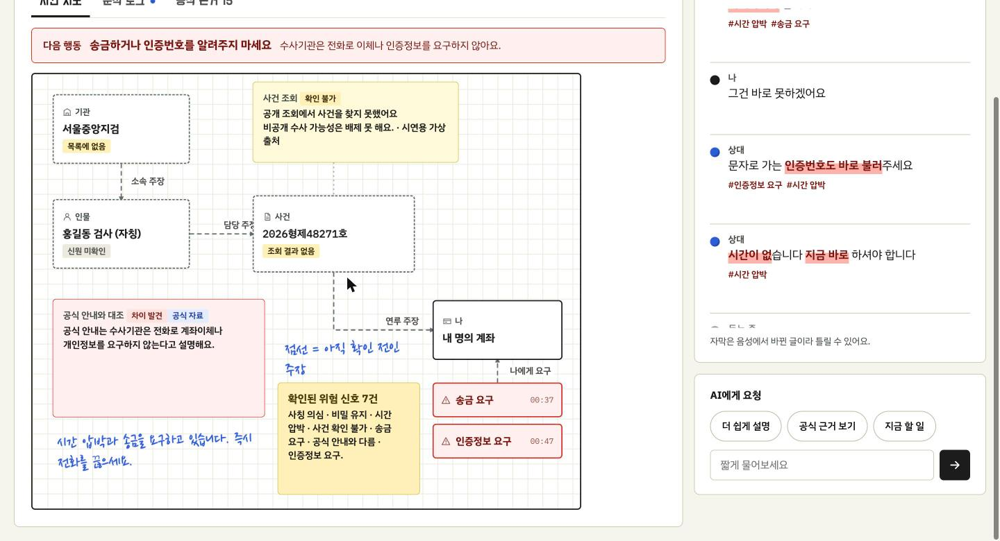
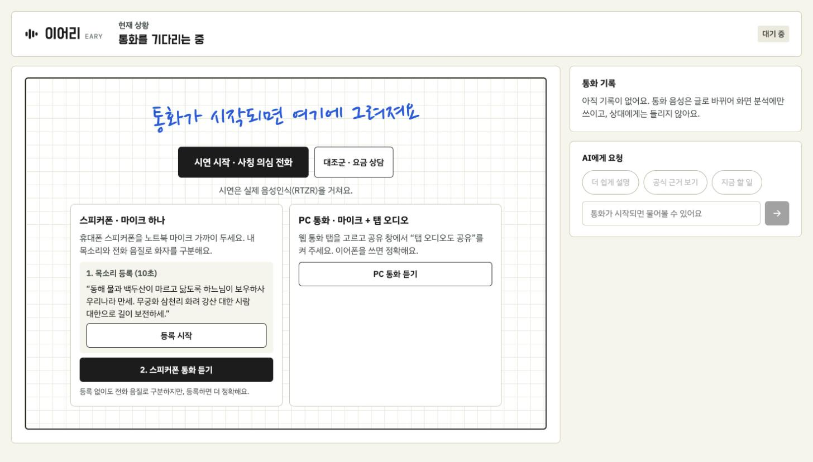
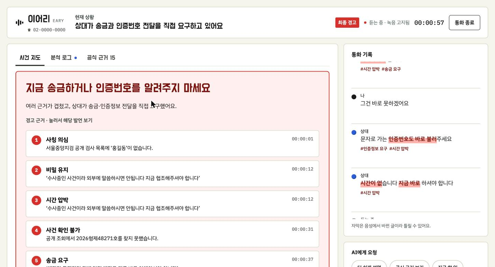
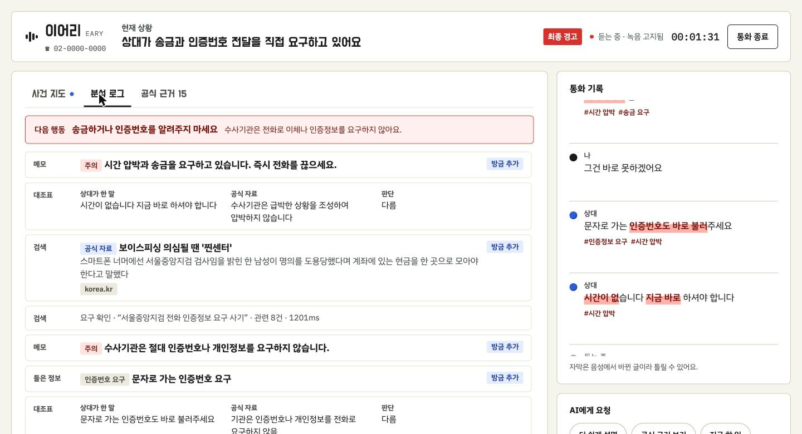
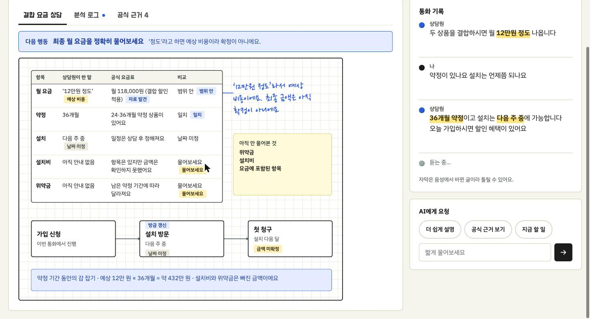
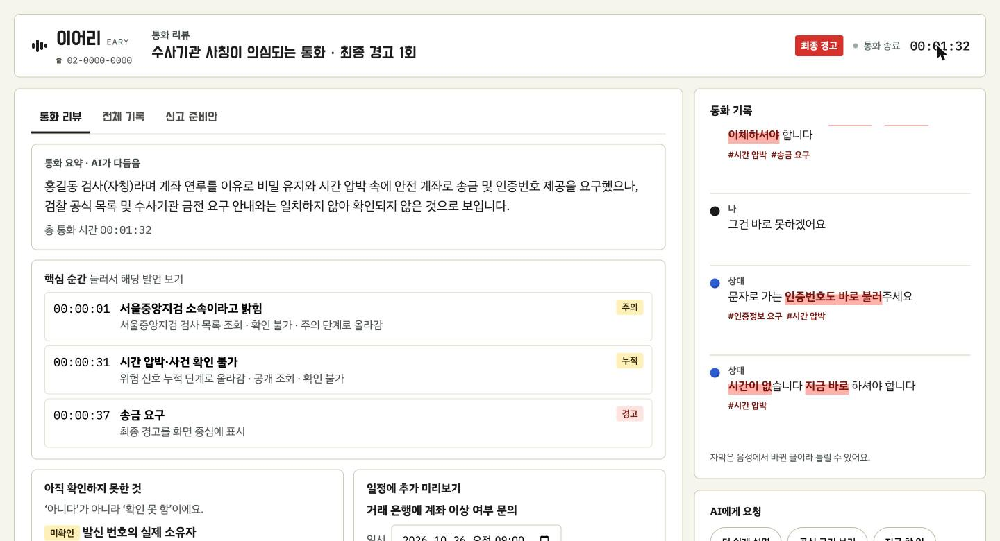
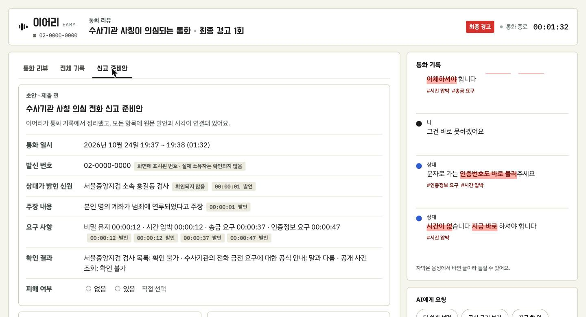
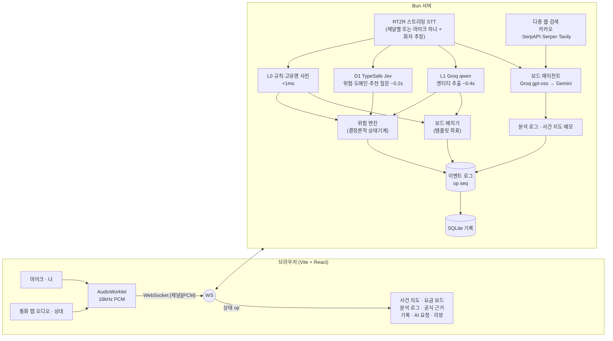

# 이어리 EARY

**통화를 함께 듣고, 판단을 돕는 AI.**

전화 속 낯선 설명을 실시간으로 받아쓰고, 기관·사람·금액·요구를 뽑아 **보드에 그림으로** 정리하고, **웹에서 공식 자료를 찾아 대조**하고, 위험이 쌓이면 **근거와 함께** 경고합니다. 통화가 끝나면 요약·핵심 순간·확인 못 한 것·신고 준비안까지 만들어 줍니다.

> 한국코드페어 해커톤 2026 출품작 · 데스크탑 웹앱 · 실시간 STT + 다중 웹 검색 + 결정론적 위험 엔진



---

## 목차
- [왜 만들었나](#왜-만들었나)
- [화면으로 보기](#화면으로-보기)
- [어떻게 동작하나](#어떻게-동작하나)
- [설계 원칙](#설계-원칙)
- [실측 성능](#실측-성능)
- [시작하기](#시작하기)
- [사용법 (실행 모드별)](#사용법-실행-모드별)
- [테스트와 확인 도구](#테스트와-확인-도구)
- [저장소 구조](#저장소-구조)
- [기술 스택](#기술-스택)
- [한계와 다음 단계](#한계와-다음-단계)
- [문서](#문서)

---

## 왜 만들었나

전화는 귀로만 듣고 바로 판단해야 하는 매체입니다. 세 가지가 어렵습니다.

| 문제 | 예 | 이어리가 하는 일 |
|---|---|---|
| **이해의 부담** | "결합하시면 월 12만 원 정도, 36개월 약정…" | 말하는 동안 정보를 뽑아 표·관계도·절차로 그린다 |
| **확인의 공백** | "서울중앙지검 홍길동 검사입니다" — 진짜인가? | 공식 자료·조회 결과와 바로 대조하고, 확인 못 한 것은 "확인 못 함"으로 남긴다 |
| **행동의 누락** | 무엇을 물어야 할지, 끊고 나서 뭘 해야 할지 | 다음에 물어볼 질문, 최종 경고, 리뷰·일정·신고 준비안 |

**이어리는 대신 행동하지 않습니다.** 통화를 끊거나, 은행에 연락하거나, 신고를 접수하지 않습니다. 판단에 필요한 근거를 보여 주고 선택은 사용자에게 맡깁니다.

---

## 화면으로 보기

| | |
|---|---|
|  |  |
| **대기** — 시연 · 스피커폰(목소리 등록) · PC 통화 중 선택 | **최종 경고** — 요구 종류에 맞는 문구 + 번호 붙은 근거, 누르면 해당 발언으로 |
|  |  |
| **분석 로그** — 에이전트가 검색·대조·판정한 과정이 최신순으로 | **요금 상담 보드** — 상담원이 한 말 vs 공식 요금표, 절차, 약정 총액 |
|  |  |
| **통화 리뷰** — 요약, 핵심 순간, 확인 못 한 것, 일정(.ics) | **신고 준비안** — 항목마다 원문 시각, 개인정보 자동 제외 |

시연 흐름(사칭 의심 전화, 약 1분): **대기 → 검사 자칭(주의) → 비밀 유지·시간 압박 → 사건번호 조회 실패(누적) → 안전계좌 이체·인증번호 요구(최종 경고) → 통화 종료 → 리뷰 → 신고 준비안**. 대조군(요금 상담)에서는 경고가 뜨지 않습니다.

---

## 어떻게 동작하나



### 판단은 네 겹으로 — 빠른 것이 먼저 그리고, 느린 것이 보강한다
| 계층 | 무엇 | 얼마나 빠른가 | 하는 일 |
|---|---|---|---|
| **L0** | 위험 어휘 사전 + 정규식 + 고유명 사전 | 1ms 미만 | 말하는 도중 형광펜·잠정 카드, 사건번호·금액·기간 정규화 ("2026 현제 4만 8271호" → `2026형제48271호`) |
| **D1** | [TypeSafe Jev](https://docs.typesafe.ai) (정해진 형태의 답만 하는 판단 모델) | 왕복 약 0.2초 | 위험 신호 판정, 통화 종류 분류, 추천 질문 고르기, 화자 추정 |
| **L1** | Groq `qwen/qwen3.8-27b` | 첫 엔티티 약 0.36초 | 사전에 없는 기관·사람 등 글로 뽑아야 하는 정보 (형식이 정해진 값은 만들 수 없음) |
| **에이전트** | Groq `gpt-oss-120b → 20b` → Gemini `flash-lite` | 단계당 0.4~1.5초 (Gemini 1~6초) | 웹 검색·페이지 읽기·대조표·판정·메모. 화면을 막지 않음 |

**위험 단계는 LLM이 아니라 규칙이 결정합니다.** LLM과 Jev는 신호 후보만 내고, 단계(주의 → 누적 → 최종 경고)는 상태기계가 계산합니다. 그래서 모든 경고에 원문 발언 근거가 붙고, 같은 입력이면 같은 결과가 나옵니다.

### 보드
- **사건 지도:** 디자인 시안의 좌표를 그대로 쓰는 템플릿 보드입니다. 기관·인물·사건·나 카드, 주장 관계(점선 = 아직 확인 전인 주장), 조회 결과, 공식 안내 대조, 위험 신호 요약, **요구 카드("나에게 요구")**, 손글씨 메모를 그립니다. 위험 신호가 생기면 사기 유형과 상관없이 열립니다.
- **요금 비교:** 상담원이 한 말 | 공식 요금표 | 비교, 아직 안 물어본 것, 가입 → 설치 → 첫 청구 절차, 약정 기간 총액.
- **좌표는 LLM이 정하지 않습니다.** 배치기가 결정론적으로 정해서 그림이 겹치거나 흔들리지 않고, 놓인 카드는 움직이지 않습니다.
- **분석 로그:** 보드 에이전트가 무엇을 검색하고, 무엇을 읽고, 어떻게 판정했는지 최신순으로 보여 줍니다.

---

## 설계 원칙

1. **속도가 곧 기능이다.** 말이 끝나고 약 0.9초 안에 위험 단계가 반영됩니다. 느린 작업은 화면을 막지 않습니다.
2. **LLM은 제안하고, 규칙이 결정한다.** 경고는 항상 설명 가능하고 재현됩니다.
3. **모든 정보는 원문 발언에 연결된다.** 카드·근거·경고·신고 준비안 항목을 누르면 그 발언으로 갑니다.
4. **"확인 못 함"은 "없음"이 아니다.** 공개 조회에서 못 찾은 것과 조회할 곳이 없는 것을 구분합니다.
5. **단정하지 않는다.** "사기입니다"는 "사기가 의심돼요"로 누그러뜨리고, 그래도 단정이면 화면에 내보내지 않습니다.
6. **확인되지 않은 전화번호는 보여 주지 않는다.** AI 답변·메모에서는 검증된 공식 번호(112·1332·1301·1577-1000·118)만 남깁니다. *(실측: AI가 검색 결과의 업체 번호를 "지검 공식 대표번호"로 안내한 적이 있어 넣은 장치)*
7. **대신 행동하지 않는다.** 끊기·연락·신고는 사용자가 직접 합니다.
8. **시연은 실패하지 않는다.** STT·Jev·L1·에이전트·검색 중 무엇이 죽어도 나머지로 계속 돌고, 카세트로 네트워크 없이 재생할 수 있습니다.

---

## 실측 성능

2026-10-24, 맥북 + 실제 API 기준 (`apps/server/test/ws-*.ts`).

| 구간 | 실측 |
|---|---|
| RTZR 확정 자막 | 말 끝 + 0.66초 |
| L0 → 잠정 카드 | p50 0.3~1.3ms |
| Jev 판정 반영 | p50 0.17~0.20초 / p95 0.22~0.28초 |
| L1 첫 엔티티 | p50 0.36초 / p95 0.44초 |
| **말 끝 → 위험 단계 반영** | **약 0.85~0.95초** |
| 웹 검색 (먼저 표시) | 1.2초 안 (카카오 40~150ms, SerpAPI 0.6~0.9초) |
| AI 답변 | 약 0.7초 |
| 스피커폰 화자 구분 | 합성 음성 10/10 (실제 사람 음성은 조정 중) |

---

## 시작하기

### 요구 사항
- [Bun](https://bun.sh) 1.4 이상 (`npm i -g bun`)
- **Chrome** (PC 통화의 탭 오디오 공유는 Chrome만 지원)
- macOS의 경우 시스템 설정 → 개인정보 보호 및 보안 → **마이크**(·**화면 및 시스템 오디오 녹음**)에서 Chrome 허용

### 설치와 실행
```bash
git clone https://github.com/d1pengh4/EARY.git && cd EARY
bun install
cp .env.example .env          # 아래 키를 채운다 (없는 키는 해당 기능만 자동으로 꺼짐)
bun --cwd apps/web run build  # 웹 빌드
bun run dev:server            # http://localhost:8787
```
개발 중에는 `bun run dev:web`(:5173, `/ws`는 8787로 프록시)을 같이 띄우면 화면이 바로 갱신됩니다.

### API 키 (`.env`)
키가 없어도 서버는 뜹니다. 없는 기능은 자동으로 꺼지고 나머지로 동작합니다.

| 키 | 용도 | 없으면 |
|---|---|---|
| `RTZR_CLIENT_ID`, `RTZR_CLIENT_SECRET` | 실시간 음성인식 ([리턴제로](https://developers.rtzr.ai)) | 시연은 텍스트 재생으로, 실제 통화 듣기 불가 |
| `TYPESAFE_API_KEY` | D1 판단 ([TypeSafe Jev](https://docs.typesafe.ai)) | L0 규칙으로 대신 판단 |
| `GROQ_API_KEY` | L1 추출 + 보드 에이전트 ([Groq](https://console.groq.com)) | 사전에 없는 기관·사람을 못 뽑고, 에이전트 꺼짐 |
| `GEMINI_API_KEY` | 에이전트 예비 ([Google AI Studio](https://aistudio.google.com/apikey)) | Groq 한도 초과 시 에이전트가 쉼 |
| `KAKAO_REST_API_KEY` · `SERPAPI_API_KEY` · `SERPER_API_KEY` · `TAVILY_API_KEY` | 웹 검색 (여러 개를 동시에 부르고 합침) | 하나도 없으면 위키백과만 |
| `NAVER_*` · `EXA_API_KEY` · `BRAVE_API_KEY` · `GOOGLE_CSE_*` | 추가 검색 공급사 (선택) | — |
| `RETENTION_DAYS` | 통화 기록 보관 일수 (기본 7) | — |
| `EARY_CASSETTE` | `record:이름` / `replay:이름` | — |

---

## 사용법 (실행 모드별)

| 모드 | 어떻게 | 언제 |
|---|---|---|
| **시연** | "시연 시작 · 사칭 의심 전화" / "대조군 · 요금 상담" | 대본 오디오(TTS 두 목소리)를 서버가 **실제 RTZR로** 흘림. 발표용 |
| **PC 통화** | "PC 통화 듣기" → 마이크 허용 → 공유 창에서 **통화 중인 Chrome 탭 + "탭 오디오도 공유"** | Discord 웹·Google Meet 등 브라우저 통화. 마이크 = 나, 탭 소리 = 상대 |
| **스피커폰** | "1. 목소리 등록"(애국가 1절, 10초) → "2. 스피커폰 통화 듣기" | 휴대폰 스피커폰을 노트북 마이크 가까이. 목소리·전화 음질·내용으로 화자 추정, "내 말이에요/상대 말이에요"로 고치면 학습 |
| **자유 입력** | `⌘⇧D` 개발 패널 → 화자 고르고 문장 입력 | 마이크 없이 아무 대화나 시험 |

**PC 통화 팁 (Discord 예)**
1. Chrome에서 `discord.com/app`으로 통화 (데스크톱 앱은 탭 공유가 안 됨)
2. 이어리 탭에서 "PC 통화 듣기" → Discord 탭 선택 → **"탭 오디오도 공유" 켜기**
3. **이어폰 권장** (스피커로 들으면 상대 목소리가 내 마이크로도 들어감)

**통화 중 할 수 있는 것**
- 기록의 발언 **"고치기"**(오인식 수정 → 보드·검색 다시 확인), **"내 말이에요 / 상대 말이에요"**(화자 바꾸기)
- **AI에게 요청**: "더 쉽게 설명", "지금 할 일", 자유 질문 ("통화를 끊어도 되나요?")
- **공식 근거** 탭: 공식 자료 / 조회 결과 / 참고로 나눠 보기
- **로고**: 처음 화면으로 (통화 중에는 두 번 눌러야 함)
- 새로고침·연결 끊김에도 통화가 이어집니다 (세션 재연결)

---

## 테스트와 확인 도구

```bash
bun test     # 55개: L0·위험 엔진·배치기·리뷰·안전장치·화자 구분·시나리오 골든·자유 실행 7편
```

| 스크립트 | 하는 일 |
|---|---|
| `bun apps/server/test/ws-e2e.ts impersonation-01 1 replay-audio` | 실행 중인 서버에 붙어 **실제 STT로** 시연 대본을 끝까지 |
| `bun apps/server/test/ws-type.ts` | 대본 밖 자유 대화 → 분석 보드 결과 출력 |
| `bun apps/server/test/ws-mono.ts [hd]` | 스피커폰(마이크 하나) 화자 구분 종단 확인 |
| `bun apps/server/test/ws-resume.ts` | 연결 끊김 → 재연결 → 빠진 op만 재전송 |
| `bun apps/server/test/ws-review.ts` | 통화 종료 → 리뷰·신고 준비안 |
| `bun apps/server/test/ws-ask.ts` | AI 답변(안전장치 포함) |
| `bun --env-file=.env apps/server/test/search-probe.ts "검색어"` | 검색 공급사별 지연·결과 |
| `BENCH_GAP_MS=6500 bun apps/server/test/l1-bench.ts` | L1 모델 벤치 ([ADR](docs/adr/l1-model.md)) |
| `bun packages/scenario/make-audio.ts impersonation-01` | 대본 → TTS 시연 오디오 (macOS) |
| `EARY_CASSETTE=record:demo` / `replay:demo` | 외부 응답 녹화 → 네트워크 없이 재생 |

실측에서 잡은 버그는 모두 회귀 테스트로 고정했습니다. 예: STT의 "2026 현제 4만 8271호", "서울중앙직검", L1이 지어낸 사건번호, 업체 전화번호 안내, U+2011 하이픈, 단정 표현, Gemini 서명 오류.

---

## 저장소 구조

```
EARY/
├─ apps/
│  ├─ server/src/          # Bun 서버
│  │  ├─ session.ts        # 통화 세션: 이벤트 로그 + 파이프라인 오케스트레이터
│  │  ├─ rtzr.ts           # RTZR 스트리밍 STT
│  │  ├─ jev.ts            # D1 TypeSafe Jev
│  │  ├─ fastLlm.ts        # L1 추출 (Groq/Cerebras/Gemini 체인)
│  │  ├─ agent.ts          # 보드 에이전트 (검색·대조·판정·메모)
│  │  ├─ groqChat.ts       # 도구 호출 체인 (한도 시 다음 모델)
│  │  ├─ search.ts         # 다중 웹 검색 + 관련성·공식 등급
│  │  ├─ verify.ts         # 조회 어댑터 (시연용 가상 데이터)
│  │  ├─ records.ts        # SQLite 통화 기록
│  │  └─ cassette.ts       # 녹화·재생
│  └─ web/src/             # Vite + React
│     ├─ Board.tsx         # 사건 지도·요금 보드 렌더러 (HTML 카드 + SVG 연결선)
│     ├─ CanvasLog.tsx     # 분석 로그
│     ├─ Evidence.tsx      # 공식 근거
│     ├─ Review.tsx        # 리뷰·전체 기록·신고 준비안
│     └─ audio.ts          # 마이크·탭 캡처 (AudioWorklet)
├─ packages/
│  ├─ schema/              # 서버·클라이언트 공용 계약 (상태·op·메시지)
│  ├─ core/                # 동형 리듀서, L0, 위험 엔진, 배치기, 리뷰, 화자 구분, 안전장치
│  └─ scenario/            # 시연 대본·오디오·자유 실행 회귀 세트·카세트
├─ data/
│  ├─ domains/             # 도메인 팩: 사전·추천 질문·보드 템플릿 (impersonation·billing·general)
│  ├─ lexicon/risk.yaml    # 공통 위험 어휘
│  └─ mock/lookups.yaml    # 시연용 가상 조회 데이터
└─ docs/                   # 아키텍처·백로그·ADR·스크린샷
```

---

## 기술 스택

| 영역 | 사용 |
|---|---|
| 런타임 | Bun 1.4 (서버·테스트·패키지), TypeScript 모노레포 |
| 서버 | `Bun.serve` WebSocket, `bun:sqlite` |
| 클라이언트 | Vite 7, React 19, Zustand, AudioWorklet |
| 음성 | RTZR 스트리밍 STT, macOS TTS(시연 오디오) |
| 판단·생성 | TypeSafe Jev, Groq (qwen3.8-27b, gpt-oss-120b/20b), Google Gemini (flash-lite) |
| 검색 | 카카오, SerpAPI, Serper, Tavily (+ 네이버·Exa·Brave·Google CSE 어댑터) |
| 디자인 | IBM Plex Sans KR · Do Hyeon · Nanum Pen Script · IBM Plex Mono |

---

## 한계와 다음 단계

- **조회 데이터는 시연용 가상 데이터입니다.** 검사 명단·사건 조회·요금표는 실제 기관 데이터가 아니며 화면에 "시연용 가상 출처"로 표시합니다.
- **휴대폰 통화를 직접 받지 못합니다.** 웹앱 구조상 PC 통화(탭 오디오) 또는 스피커폰으로 듣습니다.
- **스피커폰 화자 구분**은 TTS 합성 음성으로 검증했습니다. 실제 사람 목소리로 임계값을 조정 중입니다.
- **무료 등급 API 한도**(Groq 모델별 분당 8천 토큰 등) 때문에 에이전트가 Gemini로 떨어지면 느려집니다.
- **개인정보:** 음성 원본은 저장하지 않고(자막·근거·리뷰만, 기본 7일), 신고 준비안에서 이름·계좌번호·연락처를 자동으로 빼지만, 실제 서비스에는 녹음 고지·보관 정책의 법적 검토와 유료 등급 API가 필요합니다. Gemini 무료 등급은 입력이 제품 개선에 쓰일 수 있습니다.
- Safari는 탭 오디오 공유를 지원하지 않습니다. **Chrome을 쓰세요.**

---

## 문서
- [docs/ARCHITECTURE.md](docs/ARCHITECTURE.md) — 전체 설계, 지연 예산, 보드·위험 엔진·검증, §20 구현 현황
- [docs/BACKLOG.md](docs/BACKLOG.md) — 개발 목록과 진행 상황
- [docs/adr/l1-model.md](docs/adr/l1-model.md) — L1·에이전트 모델 선택 벤치

> 이어리는 판단을 돕는 도구이며, 사기 여부를 단정하거나 법적 판단을 대신하지 않습니다. 의심스러우면 **직접 찾은 공식 대표번호**로 확인하고, 피해가 있다면 거래 은행에 지급정지를 요청한 뒤 **112** 또는 **금융감독원 1332**로 신고하세요.
