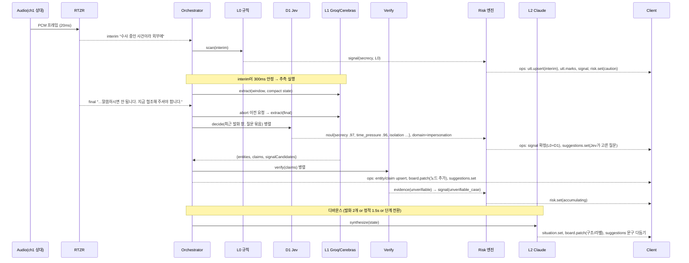
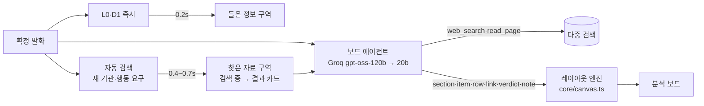
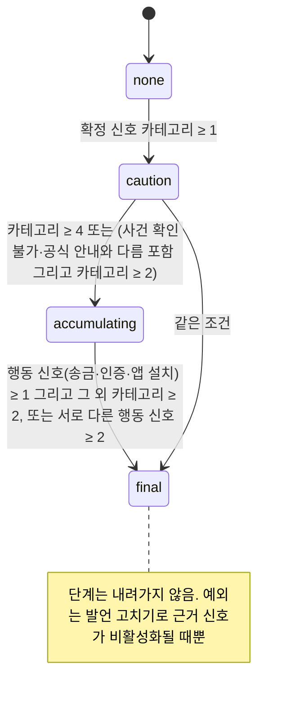

# 이어리 EARY — 개발 총괄 아키텍처

> 버전 0.1 · 2026-10-24 · 한국코드페어 해커톤
> 원천 문서: [기획서](https://eary-project-plan.nutmegmango64.chatgpt.site) · [데스크탑 디자인 캔버스](https://claude.ai/artifact/ERj5vMamYBLy3bcvBBkxQx)

---

## 0. 한 줄 정의와 설계 원칙

**"통화를 함께 듣고, 판단을 돕는 AI"** — 통화 음성을 실시간으로 글로 바꾸고, 정보를 뽑아 보드에 도식으로 그리고, 상대 주장을 검증하고, 위험 단계에 맞춰 설명 가능한 경고와 다음 질문을 제시한다. 통화가 끝나면 기록·요약·미확인 사항·후속 행동을 준다.

| # | 원칙 | 아키텍처에 미치는 영향 |
|---|---|---|
| P1 | **속도가 곧 기능이다** | 판단을 L0(규칙) → **D1(Jev 1차 의사결정)** → L1(초고속 LLM 추출) → L2(깊은 LLM)로 나눈다. 빠른 계층이 먼저 그리고 느린 계층이 보강한다. 느린 작업이 화면을 막지 않는다 |
| P2 | **LLM은 제안하고, 규칙이 결정한다** | 위험 단계(주의/누적/최종)는 결정론적 엔진이 계산한다. LLM은 신호 후보와 근거만 낸다. 그래서 경고를 항상 설명할 수 있고 재현할 수 있다 |
| P3 | **모든 정보는 원문 발언에 연결된다** | 엔티티·주장·근거·경고 모두 `sourceUtteranceIds`와 시각을 갖는다 (디자인: "눌러서 해당 발언 보기") |
| P4 | **'확인 불가'는 '없음'이 아니다** | 검증 상태 값을 엄격히 나눈다: 조회 중 / 자료 발견 / 말과 맞음 / 말과 다름 / 확인 불가 / 조회 실패 |
| P5 | **기존 도식은 유지하고 새 정보만 추가한다** | 보드는 덧붙이는 연산(op)으로만 바뀐다. 노드 ID는 안정적으로 유지하고 이미 놓인 노드의 위치는 고정한다 |
| P6 | **이어리는 대신 행동하지 않는다** | 통화를 끊거나 신고를 접수하거나 은행에 연락하는 일을 하지 않는다. 준비안·미리보기·복사·파일 저장만 제공한다 |
| P7 | **시연은 실패하지 않는다** | 대본 재생 모드 3단(실시간 / 오디오 재생 / 고정 결과 재생). 어느 계층이 죽어도 아래 단계로 내려가 계속 돈다 |

---

## 1. 결정 기록 (ADR 요약)

| 영역 | 결정 | 근거 | 탈락한 대안 |
|---|---|---|---|
| 클라이언트 | **웹앱 (Vite + React 19 + TS)**, 데스크탑 1440px 우선 | 설치가 없고 개발 속도가 가장 빠르다. 첫 화면 서버 렌더링이 필요 없다 | Next.js (SSR 불필요, 개발 서버가 무거움), Electron/Tauri (패키징·OS 권한 비용) |
| 음성 확보 | **마이크(나) + 탭/시스템 오디오(상대)를 별도 채널로** · 시연은 스테레오 대본 오디오 | 채널로 화자를 나누는 게 화자 분리 모델보다 빠르고 정확하다 | 단일 마이크 + 화자 분리 (지연·오류 큼, 예비 경로로만 둠) |
| STT | **리턴제로 RTZR 스트리밍 (WebSocket)**, 채널당 스트림 1개 | 한국어 정확도, 중간 결과(interim) 제공 | Deepgram, OpenAI, Web Speech |
| 서버 | **Bun + Hono, 네이티브 WebSocket**, 단일 프로세스 | 입출력 위주라 이벤트 루프 하나로 충분하다. TS를 클라이언트와 공유. 시작이 빠르다 | Python FastAPI (스키마 이중 관리), Go (공유 불가) |
| L0 | **인메모리 규칙 엔진** (위험 어휘 사전 + 정규식 + 패턴) | 50ms 미만. 중간 결과에도 돌릴 수 있다 | — |
| D1 | **TypeSafe Jev (`jev-latest`, System One)** — 1차 의사결정 | 글 없이 정해진 형태의 답(noul 확률 / choice / score)만 낸다. 출력 타입 오류 0. 질문 여러 개를 한 번에 병렬 처리. **실측: 한국어 질문 8개 한 번에 왕복 0.20~0.23s** (§7.4) | 위험 판단을 L1 LLM에 맡기기 (느리고 출력 형식이 흔들림) |
| L1 | **Groq / Cerebras 초고속 추론** — 텍스트가 필요한 추출 전용 (OpenAI 호환 API, 어댑터 하나) | 초당 수백~수천 토큰. 짧은 JSON 추출에 최적. 두 곳을 같은 어댑터로 바꿔 끼운다 | Claude Haiku 4.5 (L1 장애 시 예비로 유지) |
| L2 | **Claude Sonnet 5** (`claude-sonnet-5`), 스트리밍 + 프롬프트 캐싱 | 한국어 요약·도식 구조화·대화 품질 | — |
| 검증 | **공식 자료 코퍼스 사전 색인 + 조회 어댑터(시연용 가상) + 웹 검색(제한 시간 있음)** | 공식 자료가 1순위. 실시간 웹 검색은 느리고 불안정해서 2순위 | 웹 검색만 사용 |
| 상태 | **서버가 원본 상태를 갖고 이벤트 소싱**, 클라이언트는 op을 적용하는 리듀서 | 재연결 복구, 대본 재현, 골든 테스트에 유리 | 클라이언트 주도 상태 |
| 저장 | **SQLite (bun:sqlite + Drizzle)** + 로컬 오디오 파일 | 시연 노트북 한 대에서 끝남. 비동기로 쓴다 | Postgres/Supabase (해커톤 범위 밖) |
| 배포 | **시연 노트북에서 서버를 로컬 실행** (+ 예비로 원격 1대) | 내 서버까지 왕복하는 지연을 없앤다. 외부 API만 네트워크를 탄다 | — |
| 시각화 | **직접 만든 화이트보드 렌더러** (HTML 카드 + SVG 연결선), **템플릿·구역 기반 결정론적 배치기**. LLM은 좌표를 내지 않음 | 디자인 보드가 그래프가 아니라 구성 화면이다. 재현·스냅샷이 가능하다 (§8) | React Flow, tldraw, LLM이 정한 좌표 |
| 실행 모드 | **시연(대본 재생)이 기본 + 자유 실행(live / 직접 입력)** — 시나리오 이름으로 갈라지는 코드 금지, 도메인 팩으로 넓힘 | 대본 밖 대화에서도 같은 파이프라인이 돈다 (§14) | 대본 전용 하드코딩 |
| 개발 방식 | **이벤트 기반 + 시나리오 우선** | 대본 재생으로 화면 끝까지 → 진짜 STT/LLM/검색으로 단계별 교체 | 실시간 파이프라인 우선 |

---

## 2. 시스템 구성도

```mermaid
flowchart LR
  subgraph Browser["브라우저 (Vite + React)"]
    MIC[마이크 · 나] --> AW[AudioWorklet<br/>16kHz mono PCM16]
    TAB[탭/시스템 오디오 · 상대] --> AW
    SCN[대본 플레이어<br/>스테레오 WAV / 고정 결과] -.시연.-> AW
    AW -->|binary frame ch0/ch1| WS((WebSocket))
    WS -->|ops seq| STORE[Zustand 스토어<br/>공유 리듀서]
    STORE --> UI[화면: 헤더 · 보드 · 기록 · AI 채팅]
    UI -->|사용자 이벤트| WS
  end

  subgraph Server["Bun + Hono (로컬)"]
    GW[Session Gateway] --> ING[Audio Ingest<br/>채널 분리 · 녹음 파일]
    ING --> STT[STT 어댑터<br/>RTZR × 2 스트림]
    STT -->|interim/final| ORC[Pipeline Orchestrator]
    ORC --> L0[L0 규칙 엔진]
    ORC --> D1[D1 Decide<br/>TypeSafe Jev]
    ORC --> L1[L1 Fast LLM<br/>Groq / Cerebras]
    ORC --> L2[L2 Deep LLM<br/>Claude Sonnet 5]
    ORC --> VER[Verify 서비스]
    L0 & D1 & L1 & VER --> RISK[Risk 엔진<br/>결정론적 상태기계]
    D1 -.도메인·다음 질문 선택.-> BRD
    L1 & L2 --> BRD[Board 엔진<br/>덧붙이는 op]
    RISK & BRD & ORC --> ES[(이벤트 로그<br/>CallState 리듀서)]
    ES --> GW
    ES -.비동기.-> DB[(SQLite + 오디오)]
    DB --> POST[통화 후 처리<br/>리뷰 · 신고 준비안 · ICS]
  end

  STT <--> RTZR[(RTZR Streaming)]
  D1 <--> TS[(TypeSafe System One)]
  L1 <--> GQ[(Groq / Cerebras)]
  L2 <--> CL[(Anthropic API)]
  VER <--> SRC[(공식 코퍼스 · 조회 API(가상) · 웹 검색)]
```

---

## 3. 지연 예산 (Latency Budget)

기준점 **T0 = 상대 발화의 끝점**. 각 값은 시연 노트북 + 유선/안정 Wi-Fi 기준의 **목표치**이고, Phase 1에서 실측해 갱신한다.

| 구간 | 목표 (p50 / p95) | 경로 | 화면에 보이는 것 |
|---|---|---|---|
| 중간 자막 표시 | 발화 중 실시간 (~300ms 간격) | 음성 → RTZR interim → op | 기록 패널에 회색 "듣는 중…" 텍스트 |
| L0 위험 신호·하이라이트 | **T0 + 400ms / 700ms** | interim/final → 정규식·사전 | `비밀 유지`, `시간 압박` 태그, 형광펜 표시, 헤더 신호 개수 |
| 확정 자막 | T0 + 500ms / 900ms | RTZR final | 자막 확정 |
| **D1 1차 의사결정** | **final + 250ms / 500ms** (실측 왕복 ~0.2s) | final(+안정 interim) → Jev 질문 묶음 1회 | 위험 신호 확정, 통화 종류(도메인) 결정 → 기본 보드 생성, 추천 질문 선택 |
| **보드 잠정 카드** | **발화 중 (interim + 80ms / 150ms)** | L0 고유명 사전·정규식 → 미리 깔아 둔 슬롯 채우기 | 흐린 카드에 값 표시 (§8.10) |
| L1 정보 추출·위험 후보 | **T0 + 600ms / 1.0s** (엔티티 1개 단위로 흘려 적용) | final → Groq/Cerebras 스트리밍 JSON | "대화에서 추출한 정보" 행, 보드 카드 확정 |
| 위험 단계 전환 | L0/D1/L1 직후 +10ms | Risk 엔진 | 헤더 pill: 주의 → 누적 → 최종 경고 |
| 검증 결과 (공식 코퍼스·조회) | T0 + 1.2s / 2.5s | 주장 추출 즉시 병렬 조회 | 근거 카드: 조회 중 → 결과 |
| 웹 검색 근거 | 제한 시간 3s, 넘으면 "조회 실패" | 병렬 | 참고 카드 |
| L2 요약·도식 보강·추천 질문 문구 | T0 + 2s / 4s (화면을 막지 않음) | 디바운스 → Claude 스트리밍 | 현재 상황 문장, 보드 라벨·구조, AI 답변 |
| AI 채팅 첫 토큰 | 요청 + 700ms / 1.5s | Claude 스트리밍 | 채팅 말풍선 |

**실측 (2026-10-24, 시연 노트북, 실제 RTZR + Jev, `apps/server/test/ws-e2e.ts`·`ws-live.ts`)**

| 구간 | 목표 | 실측 | 메모 |
|---|---|---|---|
| RTZR 인증 | — | 161ms | 6시간 토큰, 만료 10분 전 갱신 |
| RTZR 중간 자막 간격 | ~300ms | **~2,000ms** | 가정보다 느림 → 발화 중 잠정 카드는 2초 간격으로 갱신 |
| RTZR 확정 자막 | T0 + 500ms | **T0 + 660~675ms** | 말 끝 무음 감지 포함 |
| L0 → 잠정 카드 op | 80ms | **p50 0.3~1.3ms** | |
| 확정 → D1 판정 반영 | 250ms | **p50 172~198ms / p95 206~282ms** | |
| 말 끝 → 위험 신호·단계 반영 | ~0.9s | **≈ 0.85~0.95s** | RTZR 확정 + D1 |

STT 실측에서 드러난 인식 형태 (L0에 반영, 회귀 테스트 `실제 RTZR 출력` 참고):
- "서울중앙지검" → 중간 자막에서 "서울중앙**직**검" → 고유명 사전 1글자 차이 허용 매칭(신뢰도 0.85, D1 확인 필요)
- "2026형제48271호" → "2026 **현제 4만 8271**호" → 사건 구분자 교정 + "N만 NNNN" 숫자 복원
- "범죄에" → "범**주**에" (판단에는 영향 없음)

**지연을 줄이는 장치**
1. **추측 실행:** interim 텍스트가 300ms 동안 안 바뀌고 이전 실행보다 12자 이상 늘면 L1을 미리 돌린다. 새 interim/final이 오면 이전 요청을 `AbortController`로 취소한다.
2. **결과 버전 관리:** 모든 파생 결과에 `basedOn: {utteranceId, rev}`를 붙인다. 오래된 결과(rev 불일치)는 리듀서가 버린다.
3. **연결 미리 열기:** 통화 시작 버튼을 누르기 전 대기 화면(0번)에서 RTZR 토큰 발급, LLM 연결 keep-alive, 공식 코퍼스 메모리 적재를 끝낸다.
4. **작은 입력:** L1 입력은 최근 발화 6개 + 압축한 상태 요약(엔티티 키 목록)으로 1.5k 토큰 이내. L2는 고정 시스템 프롬프트·스키마·공식 안내 요약을 앞에 두고 프롬프트 캐싱을 쓴다.
5. **스트리밍 적용:** L2 출력은 op 단위 줄바꿈 JSON(NDJSON)으로 받아 한 줄이 완성될 때마다 바로 적용한다.
6. **op 묶음 전송:** 서버는 16ms(1프레임) 안에 생긴 op을 한 메시지로 묶어 보낸다.

---

## 4. 저장소 구조 (Bun workspaces 모노레포)

```
eary/
├─ apps/
│  ├─ web/                 # Vite + React 클라이언트
│  │  ├─ src/audio/        # AudioWorklet, 캡처, 리샘플러, 대본 플레이어
│  │  ├─ src/net/          # WS 클라이언트, 재연결, seq 재생
│  │  ├─ src/store/        # Zustand + @eary/core 리듀서
│  │  ├─ src/screens/      # 대기 · 통화 중 · 리뷰 · 전체 기록 · 신고 준비안
│  │  ├─ src/board/        # 화이트보드 렌더러: HTML 요소 레이어 + SVG 연결선 레이어 + 배율 맞춤 (§8)
│  │  ├─ src/ui/           # 디자인 토큰, Card/Pill/Button/Tab/Mark 등
│  │  └─ src/dev/          # 지연 오버레이, 모드 전환 패널 (단축키로 열기)
│  └─ server/              # Bun + Hono
│     ├─ src/gateway/      # WS 세션, 인증 없음(로컬), 백프레셔
│     ├─ src/ingest/       # 채널 분리, WAV 기록
│     ├─ src/stt/          # RtzrAdapter, FixtureSttAdapter
│     ├─ src/pipeline/     # Orchestrator, 디바운스/취소/버전 관리
│     ├─ src/decide/       # Jev 클라이언트, 질문 묶음 정의, state 가공, 임계값
│     ├─ src/llm/          # FastLlm(Groq|Cerebras), DeepLlm(Claude), 프롬프트
│     ├─ src/verify/       # 어댑터: officialCorpus, prosecutorList, caseLookup, webSearch
│     ├─ src/post/         # 리뷰, 신고 준비안, ICS
│     └─ src/db/           # Drizzle 스키마, 비동기 쓰기 큐
├─ packages/
│  ├─ schema/              # zod: 이벤트, CallState, op, LLM 입출력 스키마 (단일 원천)
│  ├─ core/                # 동형(isomorphic) 리듀서, Risk 엔진, L0 규칙, board/(템플릿 해석 · 배치기 · 연결선 경로)
│  └─ scenario/            # 대본(JSON), 스테레오 WAV, 고정 LLM 응답(카세트), 골든 기대값
├─ data/
│  ├─ official/            # 공식 안내 문서 원문 + 청크 + 출처 메타
│  ├─ domains/             # 도메인 팩: impersonation · billing · general (gazetteer, lexicon, suggestions, checklist, board 템플릿, verify)
│  ├─ lexicon/             # 공통 위험 어휘 사전 (YAML, 도메인과 상관없이 늘 켜짐)
│  └─ mock/                # 시연용 가상 데이터: 검사 목록, 사건 조회 결과
└─ docs/
   ├─ ARCHITECTURE.md      # 이 문서
   └─ adr/                 # 개별 결정 기록
```

`packages/core`는 서버와 클라이언트가 **같은 리듀서**를 쓰게 한다. 서버가 보낸 op을 클라이언트가 그대로 적용하면 상태가 같아지고, 골든 테스트도 이 패키지만으로 돌릴 수 있다.

---

## 5. 도메인 모델 (`packages/schema`)

```ts
type Ms = number; // 통화 시작부터의 경과 시간(ms)

interface CallState {
  callId: string;
  mode: 'live' | 'replay-audio' | 'replay-fixture';
  phase: 'idle' | 'listening' | 'ended';
  startedAt: string; consentNotified: boolean;           // "녹음 고지됨"
  callerNumber?: string;                                  // "02-0000-0000"
  domain: 'unknown' | 'impersonation' | 'billing' | 'general'; // 사칭 의심 / 요금 상담 / ...
  situation: { text: string; rev: number };               // 헤더 "현재 상황" 한 문장
  utterances: Record<UtteranceId, Utterance>; utteranceOrder: UtteranceId[];
  entities: Record<EntityKey, Entity>;
  claims: Record<ClaimId, Claim>;
  evidence: Record<EvidenceId, Evidence>;
  signals: Record<SignalId, RiskSignal>;
  risk: RiskState;
  boards: Record<BoardId, Board>; boardOrder: BoardId[]; activeBoardId?: BoardId;
  suggestions: Suggestion[];                              // 추천 질문 · 다음 행동
  chat: ChatTurn[];
  unresolved: Unresolved[];                               // "아직 확인하지 못한 것"
}

interface Utterance {
  id: UtteranceId; speaker: 'me' | 'other'; speakerSource: 'channel' | 'inferred' | 'user';
  label: string;            // "상대" | "나" | "상담원"
  startMs: Ms; endMs: Ms;
  text: string; status: 'interim' | 'final' | 'edited';
  rev: number;              // 고치기·재인식 때마다 +1
  lowConfidenceSpans?: Span[]; // 점선 밑줄 + "인식 불확실"
  marks: Mark[];            // 형광펜: amber(정보) / red(위험) / blue(주장)
}

interface Entity {          // 기관 · 인물 · 사건 · 금액 · 일정 · 조건 · 요구
  key: EntityKey;           // 정규화한 안정 키: "org:서울중앙지검", "case:2026형제48271"
  type: 'org' | 'person' | 'case' | 'account' | 'amount' | 'date' | 'condition' | 'demand' | 'product';
  value: string; attrs: Record<string, string>;
  certainty: 'provisional' | 'claimed' | 'confirmed' | 'contradicted' | 'unknown'; // provisional = L0만(흐림), 점선 = claimed
  sources: SourceRef[];     // {utteranceId, rev, startMs}
}

interface Claim {           // "상대 주장" — 검증 대상
  id: ClaimId; subject: EntityKey; predicate: string; // "소속" | "사건 존재" | "월 요금" ...
  value: string; sources: SourceRef[];
  verification: VerificationStatus; evidenceIds: EvidenceId[];
}

type VerificationStatus =
  | 'pending'      // 조회 중
  | 'found'        // 자료 발견
  | 'match'        // 말과 맞음
  | 'mismatch'     // 차이 발견 / 말과 다름
  | 'unverifiable' // 확인 불가 — "없다는 뜻은 아니에요" (+ reason: 'not_found' | 'no_source', §14.1)
  | 'failed';      // 조회 실패 — 연결 문제, "다시 조회" 가능

interface Evidence {
  id: EvidenceId;
  tier: 'official' | 'lookup' | 'reference'; // 공식 자료 1순위 / 조회 결과 / 뉴스·후기 참고
  title: string; quote?: string; url?: string;
  scope: string;            // "확인 범위 · 서울중앙지검 공개 검사 목록, 방금 조회"
  query?: string; resultCount?: number;
  caveat?: string;          // "목록에 있어도 통화 상대가 그 사람이라는 뜻은 아니에요"
  isMock: boolean;          // "시연용 가상 출처" 배지
  checkedAtMs: Ms; linkedUtteranceIds: UtteranceId[];
}

interface RiskSignal {
  id: SignalId;
  category: 'impersonation' | 'secrecy' | 'time_pressure' | 'unverifiable_case'
          | 'official_mismatch' | 'money_transfer' | 'credential_request'
          | 'remote_app' | 'isolation';      // "다른 곳에 전화하지 마세요"
  label: string;            // "비밀 유지" | "시간 압박" | "송금 요구" | "인증정보 요구"
  origin: ('L0' | 'D1' | 'L1' | 'verify')[];
  d1Prob?: number;          // Jev noul 확률 (있을 때)
  confidence: number; sources: SourceRef[];
  explanation: string;      // 경고 근거 카드 문장
  active: boolean;          // 발언 고치기로 사라질 수 있음
}

interface RiskState {
  level: 'none' | 'caution' | 'accumulating' | 'final';
  activeCategories: RiskSignal['category'][];
  finalWarning?: { reasons: SignalId[]; shownAtMs: Ms; dismissed: boolean };
  history: { level: RiskState['level']; atMs: Ms; because: SignalId[] }[]; // 리뷰 "핵심 순간"
}
```

`Board`, `Suggestion`, `ChatTurn`, `Unresolved`는 §8 · §11에서 정의한다.

---

## 6. 이벤트 프로토콜

### 6.1 전송 계층
- 브라우저와 서버 사이에 **WebSocket 하나**를 쓴다.
- **바이너리 프레임은 음성:** `[1B channel][4B seqLE][PCM16 mono 16kHz, 20ms = 640B]`. 100ms 단위로 묶어 보내도 된다.
- **텍스트 프레임은 JSON 메시지**다.

### 6.2 클라이언트 → 서버
```ts
type C2S =
  | { t: 'hello'; callId?: string; lastSeq?: number; mode: CallState['mode']; scenarioId?: string }
  | { t: 'call.start'; consentNotified: boolean; callerNumber?: string; channels: ('me'|'other')[] }
  | { t: 'call.end' }
  | { t: 'utterance.edit'; utteranceId: string; text: string }        // 오인식 고치기
  | { t: 'utterance.speaker'; utteranceId: string; speaker: 'me'|'other' }
  | { t: 'chat.ask'; text: string; preset?: 'simplify'|'compare'|'evidence'|'todo'|'schedule' }
  | { t: 'verify.retry'; claimId: string }
  | { t: 'warning.ack'; action: 'keep_listening'|'hangup_and_check'|'open_report' }
  | { t: 'board.focus'; boardId: string } | { t: 'jump'; utteranceId: string }
  | { t: 'post.calendar'; draftId: string; patch?: Partial<CalendarDraft> }
  | { t: 'post.report.export'; format: 'copy'|'md'|'pdf' }
  | { t: 'record.delete' }
  | { t: 'type.inject'; speaker: 'me'|'other'; text: string };  // 자유 입력 모드: STT final처럼 주입
```

### 6.3 서버 → 클라이언트
```ts
type S2C =
  | { t: 'welcome'; callId: string; snapshot?: CallState; seq: number }
  | { t: 'ops'; from: number; ops: Op[] }       // seq가 연속이면 적용, 끊기면 hello로 다시 요청
  | { t: 'chat.delta'; turnId: string; delta: string }  // 스트리밍 토큰 (op과 분리해 가볍게)
  | { t: 'metrics'; spans: LatencySpan[] }      // 개발 오버레이용
  | { t: 'error'; code: string; recoverable: boolean };

type Op =
  | { op: 'utt.upsert'; u: Utterance }
  | { op: 'utt.marks'; id: string; rev: number; marks: Mark[] }
  | { op: 'entity.upsert'; e: Entity }
  | { op: 'claim.upsert'; c: Claim }
  | { op: 'evidence.upsert'; ev: Evidence }
  | { op: 'signal.upsert'; s: RiskSignal }
  | { op: 'risk.set'; risk: RiskState }
  | { op: 'situation.set'; text: string; rev: number }
  | { op: 'board.create'; board: BoardHeader }
  | { op: 'board.patch'; boardId: string; patch: BoardPatch }   // §8
  | { op: 'suggestions.set'; items: Suggestion[] }
  | { op: 'chat.turn'; turn: ChatTurn }
  | { op: 'unresolved.set'; items: Unresolved[] }
  | { op: 'phase.set'; phase: CallState['phase'] };
```

**규칙**
- 서버는 `seq`를 하나씩 올리는 이벤트 로그를 갖는다.
- 재연결하면 클라이언트가 `lastSeq`를 보내고 서버가 빠진 부분을 다시 보낸다. 범위를 넘으면 스냅샷을 보낸다.
- 모든 op은 **같은 걸 두 번 적용해도 결과가 같고**(upsert), `rev`를 비교해서 오래된 값으로 덮어쓰지 않는다.

---

## 7. 실시간 파이프라인 (Orchestrator)



### 7.1 트리거 표

| 입력 | L0 | D1 Jev | L1 | Verify | L2 |
|---|---|---|---|---|---|
| STT interim | ✅ 매번 | L0가 행동 신호(송금·인증)를 잡으면 즉시 | 300ms 안정 + 12자 이상 늘면 추측 실행 | — | — |
| STT final | ✅ | ✅ 매번 (질문 묶음 1회) | ✅ (추측 결과가 같으면 재사용) | 새 주장이 있으면 | 디바운스 큐에 넣음 |
| 검증 결과 도착 | — | ✅ `official_mismatch` 판정 질문만 | — | — | — |
| 위험 단계 상승 | — | — | — | — | **즉시** (현재 상황 문장 + 경고 문구) |
| `utterance.edit` | ✅ 해당 발화 | ✅ | ✅ 해당 발화 + 앞뒤 | 영향받은 주장만 | 디바운스 |
| `chat.ask` | — | 프리셋 분류 (자유 질문 → 의도 choice) | — | 프리셋에 따라 | ✅ 즉시, 스트리밍 |
| `call.end` | — | 최종 분류 (통화 유형, 피해 가능성) | — | — | ✅ 리뷰·준비안 생성 |

### 7.2 동시 실행 정책
- **L1:** 채널별로 실행 중 최대 1개, 대기 최대 1개. 새 요청이 오면 대기 중인 것을 교체하고 실행 중인 것은 취소한다.
- **L2:** 세션 전체에서 실행 중 1개. 단계 전환과 채팅은 우선순위 큐로 앞에 끼워 넣는다.
- **Verify:** 주장마다 1회만 조회한다(같은 키는 하나로 합침). 어댑터별로 제한 시간이 있다.

### 7.3 STT 어댑터 (RTZR)
- **연결:** 서버에서 `POST /v1/authenticate`로 JWT를 받아 캐싱하고 만료 전에 갱신한다. 채널마다 스트리밍 WebSocket 1개를 연다(`sample_rate=16000`, `encoding=LINEAR16`, `use_itn=true`). 정확한 엔드포인트·파라미터·키워드 부스팅·화자 분리 지원 여부는 **Phase 1에서 문서로 확인**한다.
- **화자 판별 우선순위:** ① 채널(ch0=나, ch1=상대) → ② 단일 마이크 모드에서는 L1의 화자 역할 추론 → ③ 사용자 수정(`utterance.speaker`).
- **인터페이스:** `SttAdapter { start(channel), push(pcm), on('interim'|'final'), stop() }`. 구현체는 `RtzrAdapter`(실시간), `FixtureSttAdapter`(대본 타임라인대로 interim/final 방출) 두 개다.

### 7.4 D1 1차 의사결정 — TypeSafe Jev

**역할:** "말을 만들 필요가 없는 판단"을 모두 맡는다. 위험 신호 판정, 통화 종류(도메인) 분류, 화자 추정, 추천 질문·다음 행동 **선택**(후보 목록 중에서), 주장과 공식 안내의 맞음/다름 판정, 채팅 의도 분류.
**하지 않는 것:** 엔티티 값 뽑기(글 생성 불가 → L1), 금액 계산·날짜 해석(Jev가 약함 → L0 정규식과 코드), 문장 쓰기(→ L2).

- **API:** `POST https://api.typesafe.ai/v1/systemone`, `Authorization: Bearer $TYPESAFE_API_KEY`, `model: "jev-latest"`. 응답 `model`은 고정 버전(실측 `jev-1.14.0`)으로 오므로 로그에 남겨 재현성을 확보한다. Node SDK `@typesafe-ai/sdk`(`choice`, `noul`, `score` 헬퍼)를 써도 되고 `fetch`로 직접 불러도 된다.
- **한 번에 다 묻는다:** 판단 질문을 **한 요청에 묶어** 병렬로 처리한다. 순서대로 따로 부르지 않는다.
- **state 가공:** 최근 발화 창(기본 3~4개, 화자 라벨 포함) + 짧은 맥락(`domain`, 이미 켜진 신호 카테고리). 노이즈가 많으면 정확도가 떨어지므로 전체 기록을 넣지 않는다. 긴 맥락 헤더는 쓰지 않는다.
- **질문 묶음 (`decide/questions.ts`):**
```ts
const perUtterance = {
  impersonation:      noul('상대가 수사기관·금융기관 등 공공기관 소속이라고 주장하는가?'),
  secrecy:            noul('상대가 통화 내용을 다른 사람에게 말하지 말라고 요구하는가?'),
  isolation:          noul('상대가 다른 곳에 연락하거나 전화를 끊지 말라고 하는가?'),
  time_pressure:      noul('상대가 즉시 또는 짧은 기한 안에 행동하라고 압박하는가?'),
  money_transfer:     noul('상대가 송금이나 계좌 이체를 요구하는가?'),
  credential_request: noul('상대가 인증번호·비밀번호 등 인증정보를 요구하는가?'),
  remote_app:         noul('상대가 앱 설치나 원격 제어를 요구하는가?'),
  domain:  choice('이 통화는 어떤 종류의 상담인가?', { impersonation:'기관 사칭이 의심되는 통화', billing:'요금·가입 상담', general:'그 외 일반 상담' }),
  speaker: choice('마지막 발화를 한 사람은?', { me:'사용자', other:'상대' }),   // 단일 마이크 모드에서만
  next:    choice('사용자가 지금 하면 가장 도움이 될 것은?', SUGGESTION_CATALOG[domain]), // 후보는 도메인별 카탈로그
};
```
- **추천 질문은 "고르기"다:** 후보 문구(예: "사건번호를 물어보세요", "공식 대표번호로 다시 걸겠다고 말하기", "위약금을 물어보세요")는 `data/suggestions/*.yaml` 카탈로그에 미리 써 둔다. Jev는 그중 하나를 고르고, L2는 나중에 필요하면 말투만 다듬는다. 그래서 추천 질문이 0.3초 안에 뜬다.
- **임계값 (확신도 3구간):** 신호 noul이 `≥ 0.85`면 확정, `0.5~0.85`면 L0나 L1 중 하나가 같이 잡아야 확정, `< 0.5`면 버린다. 도메인 choice는 `confidence ≥ 0.8`이면 기본 보드를 만들고, 그 아래면 `unknown`으로 둔다.
- **전체 위험도 점수(`score`)는 단계 결정에 쓰지 않는다:** 실측에서 송금 요구가 아직 없는데도 `score 2.97(즉시 경고)`이 나왔다. 단계는 §9 상태기계가 카테고리별 noul로 계산한다. score는 리뷰 화면의 참고 값과 로그로만 쓴다.
- **도메인에 따라 거르기:** 실측에서 요금 상담의 "오늘 가입하시면 할인"도 `time_pressure 0.80`으로 잡혔다. `billing`/`general` 도메인에서는 `time_pressure`·`secrecy` 단독으로 단계를 올리지 않는다(§9).
- **실측 (2026-10-24, 질문 8개 묶음, 입력 약 830토큰):**

| 대본 | 왕복 | 주요 결과 |
|---|---|---|
| 사칭 (발화 3개) | 0.195 / 0.225 / 0.231s | impersonation .97 · secrecy .97 · time_pressure .96 · money .20 · credential .15 · domain=impersonation(1.0) · next=ask_callback(.81) |
| 요금 상담 (발화 3개) | 0.213s | impersonation .07 · secrecy .03 · **time_pressure .80** · domain=billing(.98) · next=ask_fee(.97) · score .40 |

- **비용:** 입력 100만 토큰당 $0.042, 출력은 무료(공개 자료 기준). 발화마다 1회 호출해도 시연 비용은 거의 0이다.
- **실패 처리:** 제한 시간 600ms. 넘거나 실패하면 해당 판단은 L0 + L1 signalCandidates로 대신한다. 연속 3회 실패하면 서킷을 연다.

### 7.5 L1 Fast LLM (Groq / Cerebras)
- **어댑터:** OpenAI 호환 `chat.completions` 하나로 만들고, `provider`, `model`, `baseURL`은 환경 변수로 바꾼다. JSON 모드나 구조화 출력을 쓰고, 결과는 zod로 검증한다. 실패하면 1회 재시도하고, 그래도 실패하면 버린다(L0 결과는 남아 있음).
- **후보 모델:** Phase 1 벤치마크로 고른다. 기준은 ① 한국어 엔티티 추출 F1, ② 첫 토큰·완료 지연, ③ JSON 유효율. 공급사가 그 시점에 서비스 중인 Llama / Qwen / gpt-oss 계열 중에서 비교한다.
- **예비:** L1이 장애이면 Claude Haiku 4.5(`claude-haiku-4-5`)로 자동 전환한다(서킷 브레이커: 연속 3회 실패 또는 p95가 2초를 넘으면).
- **출력 스키마 (요약):**
```ts
{ entities: {type, value, attrs?, certainty: 'claimed'|'confirmed', quote}[],
  claims: {subject, predicate, value, quote}[],
  relations: {from: EntityKey, to: EntityKey, label, quote}[],   // 보드 claim 연결선 (§8.4)
  signalCandidates: {category, quote, confidence, why}[] }  // D1이 죽었을 때 예비 + 신호의 원문 인용(quote) 제공
// 도메인 분류·화자 추정·추천 질문 선택은 D1(Jev)으로 옮겼다. L1은 "값을 글로 뽑아야 하는 것"만 맡는다.
```
- **환각 방지:** 모든 항목에 `quote`(원문 일부)를 반드시 넣게 하고, 서버에서 원문에 실제로 들어 있는지 대조한다. 없으면 버린다.
- **흘려 받기:** 출력 키 순서를 `entities → relations → claims → signalCandidates`로 고정한다. 부분 JSON 파서로 배열 원소가 닫힐 때마다 바로 내보낸다(§8.10). 형식이 정해진 값(숫자·날짜·사건번호)이 L0와 다르면 L0 값을 쓴다.

### 7.6 L2 Deep LLM (Claude Sonnet 5)
- **용도:**
  - 현재 상황 한 문장
  - 보드 구조화: 관계·절차·비교표 축 정하기, 라벨 다듬기
  - 추천 질문 문구를 사용자 말투로 다듬기
  - AI 채팅: 더 쉽게 설명 / 조건 비교 / 공식 근거 보기 / 지금 할 일 / 일정 정리
  - 통화 후: 요약, 핵심 순간, 미확인 사항, 신고 준비안, 일정 초안
- **출력 형식:** 보드는 **의미 단위 op NDJSON**(메모 추가, 라벨 다듬기, 답변 카드)으로 받는다. **좌표는 내지 않는다**(배치는 §8.5 배치기가 정함). 전체 도식을 다시 그리게 하지 않고 "추가·수정할 op만" 내게 한다.
- **프롬프트 캐싱:** 시스템 프롬프트, op 스키마, 공식 안내 요약, 문체 규칙("단정하지 않기", "확인 못 함 ≠ 아님")을 캐시 대상 앞부분에 고정한다.
- **경계:** L2는 `risk.level`을 바꿀 수 없다. 신호 후보만 낼 수 있고 판단은 Risk 엔진이 한다.

---

## 8. 보드 엔진과 캔버스 시각화

### 8.0 결정 요약

| 항목 | 결정 | 이유 |
|---|---|---|
| 그리는 방식 | **직접 만든 화이트보드 렌더러**: 논리 좌표계 위에 HTML 카드(절대 위치) + SVG 연결선 레이어 1장 | 디자인 보드는 그래프가 아니다. 카드·표·단계·설명 박스·손글씨 메모를 섞은 **구성 화면**이다. 한국어 줄바꿈·접근성(실제 버튼, 읽기 순서)은 HTML이 낫다 |
| 쓰지 않는 것 | React Flow, tldraw, Excalidraw, Canvas 2D, Mermaid | 드래그·확대 같은 편집 기능이 필요 없고, 디자인과 스타일이 충돌한다. Canvas는 텍스트 접근성이 없다 |
| 누가 위치를 정하나 | **LLM은 좌표를 내지 않는다.** L1/L2/D1은 의미 단위 연산(엔티티·관계·행·단계·메모)만 낸다. `packages/core`의 **배치기(placer)**가 템플릿 구역 규칙으로 좌표를 결정론적으로 계산한다 | 같은 입력이면 같은 그림이 나와서 재현·스냅샷·골든 테스트가 된다. LLM 좌표는 겹치고 흔들린다 |
| 어디서 계산하나 | 서버에서 계산하고 좌표를 op에 담아 보낸다 (클라이언트도 같은 코드라 검증만 함) | "그때의 보드" 스냅샷이 이벤트 로그 재생만으로 정확히 재현된다 |
| 레이아웃 기법 | **템플릿 + 구역(zone) + 슬롯**. 슬롯이 넘치면 구역 안 격자의 다음 빈칸에 놓는다. 일반 그래프 레이아웃 라이브러리는 쓰지 않는다 | 디자인 시안 그대로 놓이고, 증분 배치에서 기존 노드가 움직이지 않는다 |

### 8.1 좌표계와 크기 맞춤
- **논리 폭 880px**(디자인 `host` 폭), 높이는 템플릿 기본값(560~640)에서 시작해 아래로만 늘어난다.
- 화면 폭에 맞춰 `transform: scale(w/880)`으로 키우거나 줄인다. 배율은 `0.85~1.3`으로 제한하고, 0.85보다 좁으면 디자인처럼 `overflow-x: auto`로 가로 스크롤한다.
- 배경은 디자인의 격자 `host`(흰 바탕 + 24px 격자, 2px 잉크 테두리)를 쓴다.
- 레이어는 3장이다(아래부터): ① SVG 연결선 레이어(`pointer-events: none`) ② HTML 요소 레이어 ③ 손글씨 메모와 배지 레이어.

### 8.2 시각 문법 (디자인에서 뽑은 규칙 — 의미가 모양을 정한다)

| 의미 | 요소 | 모양 |
|---|---|---|
| 상대가 **주장만 한** 사실 (`certainty=claimed`) | 엔티티 카드 | `2px dashed #5E6D68`, 흰 바탕 |
| 확인된 사실 / 나 | 엔티티 카드 | `2px solid #1B1B1B` |
| 말과 다름 (`contradicted`) | 엔티티 카드 | 실선 `--red` 테두리 + `p-red` 상태 pill |
| 새로 추가 | 카드 | `p-teal` "방금 추가" pill + `box-shadow: 0 0 0 5px #DCE7FF` 후광 4초 |
| 주장 관계 (소속·담당·연루 주장) | 연결선 | `#5E6D68` 2px, `dasharray 6 6`, 화살촉, 가운데 라벨(`alab` 14px) |
| 근거 연결 (조회 결과 ↔ 대상) | 연결선 | `#9CABA6` 2px, `dasharray 1 6`(점점선), 화살촉 없음 |
| 순서 (절차 단계) | 연결선 | `#5E6D68` 2px 실선 + 화살촉 |
| 손글씨 메모가 가리키는 대상 | 연결선 | `--blue` 2px 실선 + 화살촉 |
| 확인 불가 · 주의 설명 | 설명 박스(callout) | `#FFF9DA` 바탕, `1px #D9C34A`, `p-amber` 상태 pill |
| 차이 발견 · 위험 | 설명 박스 | `#FFF1EE` 바탕, `1px --red`, `p-red` |
| 신호 요약 | 설명 박스 | `#FFF0B8` 바탕 |
| 안내 · 다음 할 일 | 정보 띠(banner) | `#E4ECFF` 바탕, `--blue` 테두리, 폭 전체 |
| 이어리의 짧은 해설 | 손글씨 메모(hand) | `Nanum Pen Script` 28px `--blue`, `rotate(-1.5~-2deg)`, **보드당 최대 2개** |
| 비교 | 표(table) | `tbl`/`th`/`td`. 방금 바뀐 행은 `#FFF9DA`, 조회 중인 칸은 skeleton + "조회 중…" |

- 상태 pill 문구는 §5의 `VerificationStatus`와 1:1로 대응한다(조회 중 / 자료 발견 / 말과 맞음 / 차이 발견 / 확인 불가 / 조회 실패). 화면마다 문구를 따로 만들지 않는다.
- **색만으로 구분하지 않는다:** 점선·실선·점점선 + pill 글자로 함께 구분한다(색각 이상 대응).

### 8.3 요소 모델
```ts
type BoardEl =
  | { kind: 'card';    id: string; entityKey?: EntityKey; zone: string; label: string; value: string;
      pills: PillSpec[]; sub?: string; style: 'provisional'|'claimed'|'confirmed'|'contradicted'|'me' }
  | { kind: 'callout'; id: string; zone: string; tone: 'amber'|'red'|'signal'|'info';
      title: string; body: string; pills: PillSpec[]; evidenceIds?: EvidenceId[] }
  | { kind: 'table';   id: string; zone: string; columns: string[]; rows: BRow[] }
  | { kind: 'step';    id: string; zone: string; order: number; title: string; sub?: string; pills: PillSpec[] }
  | { kind: 'hand';    id: string; zone: string; text: string; pointsTo?: string }
  | { kind: 'banner';  id: string; zone: string; text: string; action?: SuggestionId }
  | { kind: 'answer';  id: string; zone: string; question: string; atMs: Ms; bodyMd: string; chips: SourceRef[] };

interface BEdge { id: string; from: string; to: string; kind: 'claim'|'evidence'|'sequence'|'pointer'; label?: string }
interface Placed { id: string; x: number; y: number; w: number; h: number } // 배치기가 정한 값
```
- 모든 요소에 `sources`(원문 발언)가 붙는다. 요소를 누르면 기록 패널이 해당 발언으로 이동한다(`jump` 이벤트).

### 8.4 템플릿 (도메인 팩마다 하나 이상)
템플릿은 `data/domains/<domain>/board.*.yaml`에 **구역(zone) 사각형 + 슬롯 + 관계 규칙**으로 선언한다. 코드는 템플릿을 해석하기만 한다.

**사칭 `entityMap` (2번 화면 그대로)**
```yaml
id: impersonation.entityMap
size: { w: 880, h: 640 }
zones:
  identity: { x: 32,  y: 32,  w: 220, h: 300, flow: column, gap: 56, slots: [org, person] }
  subject:  { x: 352, y: 194, w: 260, h: 124, slots: [case] }
  target:   { x: 640, y: 362, w: 208, h: 96,  slots: [me_account] }
  lookup:   { x: 352, y: 12,  w: 330, h: 130, accepts: callout, attachTo: subject }   # 사건 조회 결과
  official: { x: 32,  y: 360, w: 340, h: 190, accepts: callout }                      # 공식 안내 대조
  signals:  { x: 392, y: 500, w: 456, h: 112, accepts: callout(signal) }
  overflow: { x: 640, y: 32,  w: 208, h: 300, flow: column, gap: 16 }                 # 자유 실행에서 생긴 추가 엔티티
slots:
  org:        { match: { type: org } }
  person:     { match: { type: person } }
  case:       { match: { type: case } }
  me_account: { match: { type: account, owner: me }, style: me }
relations:
  - { from: org,    to: person,     kind: claim, label: 소속 주장 }
  - { from: person, to: case,       kind: claim, label: 담당 주장 }
  - { from: case,   to: me_account, kind: claim, label: 연루 주장 }
```

**요금 `compareTable` + `procedure` (5·11번 화면)**
- 구역: `table`(32,32, 500×340) · `aside`(580,32 — 손글씨 메모 + "아직 안 물어본 것" 설명 박스) · `steps`(32,408, 가로 흐름, 단계 사이 실선 화살표) · `footer`(32,540, 정보 띠).
- 표의 행 순서는 팩에 고정한다(월 요금 → 약정 → 설치 → 설치비 → 위약금). 목록에 없는 항목은 맨 아래에 붙인다.
- "아직 안 물어본 것"은 팩 체크리스트에서 채워진 항목을 뺀 나머지로 결정론적으로 계산한다.

**`lookup`(1번), `aiAnswer`(8번)**
- `lookup`: 왼쪽에 검색어 + 결과 표, 오른쪽에 위에서부터 확인 범위 → 조회 결과 → 이어리의 해석 → 다음 행동.
- `aiAnswer`: 답변 카드를 지그재그로 쌓는다(왼쪽 480 / 오른쪽 520, 새 답은 아래 다음 칸). 손글씨 메모 "물어본 답은 이렇게 보드에 남아요"는 첫 답변 때만 붙인다.

**`general` (자유 실행용 기본 템플릿 — §14.1)**
- 구역:
  - `facts`: 3열 격자. 엔티티 카드를 타입 순서(기관 → 인물 → 금액 → 일정 → 조건 → 요구)로 채운다.
  - `timeline`: 날짜·시간 엔티티를 가로 흐름으로.
  - `checks`: 확인한 근거 설명 박스.
  - `todo`: 아직 안 물어본 것 / 다음 할 일.
  - `footer`: 정보 띠.
- 관계가 생기면(L1 `relations`) 같은 구역 안 카드끼리만 claim 연결선을 긋는다. 구역을 가로지르는 선은 긋지 않아 지저분해지지 않는다.

### 8.5 배치기(placer) 규칙 — `packages/core/board/place.ts`
1. **슬롯 우선:** 새 요소가 슬롯 `match`에 맞고 그 슬롯이 비어 있으면 거기에 놓는다.
2. **넘침:** 슬롯이 이미 찼거나 맞는 슬롯이 없으면 `overflow`(없으면 `facts`) 구역의 `flow` 방향으로 다음 빈칸에 놓는다.
3. **크기:** 요소 종류별 고정 크기 표를 쓴다(카드 220×112, 사건 카드 260×124, 단계 230×100). 텍스트는 2줄에서 자르고(`line-clamp`) 전체는 툴팁·상세에서 본다. 표는 행이 늘면 아래로 자란다.
4. **위치 고정:** 놓인 요소의 x는 절대 바뀌지 않는다. y는 **위쪽 구역이 자랄 때 그 아래 구역 전체가 같이 내려가는 경우에만** 바뀐다(200ms 전환). 요소가 다른 구역으로 옮겨 가는 일은 없다.
5. **연결선 경로:** 요소 사각형 4변의 중점을 포트로 쓰고, 가장 가까운 포트 쌍 사이에 직선 또는 ㄱ자 꺾은선 1회를 긋는다. 라벨은 선의 중점에 놓는다. 요소를 가로지르면 반대쪽으로 꺾은 경로로 한 번 다시 시도한다.
6. **템플릿 전환:** `domain`이 바뀌면 새 템플릿 보드를 **새 탭**으로 만든다. 기존 보드는 바꾸지 않는다(P5).
7. **결정론:** 같은 op 순서면 같은 좌표가 나온다. 무작위·시간 의존 값을 쓰지 않는다. 손글씨 메모 회전각도 `hash(id)`로 정한다.

### 8.6 갱신 연산 (BoardPatch)
```ts
type BoardPatch =
  | { add: { els?: BoardEl[]; edges?: BEdge[] }; placed: Placed[] }  // 서버 배치기가 좌표까지 계산해서 보냄
  | { update: { id: string; fields: Partial<BoardEl>; reason?: string } } // 상태 pill, 값, style만 바뀜
  | { grow: { zone: string; dy: number; shifted: Placed[] } }       // 구역이 자라서 아래 구역이 내려감
  | { badge: { id: string; text: '방금 추가' | '방금 갱신'; ttlMs: number } };
// 삭제 연산은 없다. 틀린 정보는 style='contradicted' 또는 '철회됨' pill + 흐리게(opacity .45) 표시한다.
```
- **입력별 처리:**
  - L1 `entity.upsert` → 배치기가 `card` 요소를 만든다.
  - Verify `evidence.upsert` → `callout` 요소 + `evidence` 연결선.
  - D1 `next` → `banner` 요소.
  - L2 → `hand` 메모, 라벨 다듬기, `answer` 요소만.

### 8.7 움직임
- 새 요소는 120ms 페이드인 + 4px 위로 떠오름, 연결선은 `stroke-dashoffset`으로 180ms 동안 그려짐.
- **내용은 즉시 보인다.** 같은 프레임에 요소가 여러 개 오면 60ms 간격으로 엇갈려 등장시킬 뿐, 기다리게 하지 않는다(§8.10).
- `prefers-reduced-motion`이면 애니메이션 없이 후광 배지만 보인다.
- 최종 경고 상태에서는 보드 영역을 `FinalWarning`이 차지한다. 보드는 탭으로 계속 볼 수 있다(디자인 3번).

### 8.8 보드 탭과 스냅샷
- 탭 줄에는 보드 제목과 상태 배지(방금 갱신 / 새 보드)를 붙인다. 활성 보드가 아닌 곳에 변화가 생기면 탭에 점을 표시한다. **자동으로 탭을 바꾸지 않는다.** 사용자가 보던 걸 빼앗지 않기 위해서다. 예외는 첫 보드 생성과 최종 경고뿐이다.
- `snapshot(atMs)`: 이벤트 로그를 `atMs`까지 재생해 보드를 다시 그린다(6번 "그때의 보드"). 좌표가 op에 들어 있어서 계산 없이 재생만 하면 된다.

### 8.9 안정성 규칙 요약
1. 요소 ID = 엔티티 키(카드) 또는 `evidenceId`·`claimId`에서 만든 키 → 같은 대상을 다시 말하면 갱신된다.
2. 사실 값은 L0/D1/L1/Verify가 이기고, 표현(라벨·메모)은 L2가 정한다.
3. 위치는 배치기만 정한다. x는 바뀌지 않고, y는 구역이 자랄 때만 바뀐다.
4. "방금 추가/갱신" 배지는 4초 뒤 사라진다.
5. 잠정(provisional) 요소만 확정 전에 사라질 수 있다 (§8.10).

### 8.10 캔버스 고속 경로 — 빠르고 정확하게

**목표:** 상대가 말한 정보가 **말하는 도중에** 보드에 나타나고(잠정), 말이 끝나고 1초 안에 확정된다. 확정 뒤에는 값이 뒤집히지 않는다.

#### 지연 목표 (보드 전용)

| 단계 | 목표 p50 / p95 | 만드는 쪽 | 보드에 보이는 것 |
|---|---|---|---|
| ① 잠정 카드 | **interim 수신 + 80ms / 150ms** (발화 중) | L0 사전·정규식 | 슬롯 자리에 카드가 뜨고 값이 채워짐. 흐린 테두리 + "듣는 중" pill |
| ② 슬롯·도메인 확정 | final + 250ms / 500ms | D1 Jev | 템플릿 결정, 잠정 카드의 슬롯 확정, 추천 질문 띠 |
| ③ 값 확정 | **final + 600ms / 1.0s** | L1 스트리밍 (엔티티 1개가 완성될 때마다 적용) | 점선/실선 스타일 확정, 관계선 그려짐 |
| ④ 근거 박스 | final + 1.0s / 2.0s | Verify | 조회 결과 설명 박스 + 점점선 |
| ⑤ 해설 | final + 2s / 4s | L2 | 손글씨 메모, 라벨 다듬기 |
| 화면 반영 | op 수신 → 다음 프레임 (**16ms 이내**) | 클라이언트 | — |

#### 속도를 만드는 장치

1. **L0 고유명 사전(gazetteer)으로 LLM 없이 먼저 그린다.**
   - `data/domains/*/gazetteer.yaml`에 기관명(정식명 + 별칭: `서울중앙지검` = `서울중앙지방검찰청`), 직함(검사·수사관·팀장·상담원), 상품명, 은행명을 둔다.
   - 사람 이름은 `([가-힣]{2,4})\s?(검사|수사관|팀장|과장|대리)` 패턴으로, 사건번호·금액·기간·날짜는 §9.1 정규식으로 잡는다.
   - 매칭은 Aho-Corasick(사전 전체 1회 순회) + 정규식이다. 발화당 1ms 미만.
   - interim마다 돌려서 **말이 끝나기 전에** 카드를 띄운다.
2. **슬롯은 보드를 만들 때 미리 깔아 둔다.**
   - 템플릿을 만드는 순간 모든 슬롯의 좌표·크기·연결선 경로를 **미리 계산**해 둔다(보이지 않는 자리 표시).
   - 그 뒤 요소 추가는 "빈 슬롯 채우기" 하나뿐이다. 레이아웃 계산도, 연결선 경로 계산도, DOM 측정도 없다.
   - 넘침 구역의 격자 칸 좌표도 미리 만들어 둔다.
3. **템플릿을 추측해서 미리 띄운다.**
   - 첫 발화의 L0 결과로 가장 가능성 높은 도메인 템플릿(예: 기관명 + 직함 → 사칭)을 바로 연다.
   - 확신이 없으면 `general` 템플릿을 연다(모든 엔티티 타입 슬롯이 있어 어떤 값이 와도 놓을 수 있음).
   - D1이 다른 도메인으로 확정하면 **새 탭**을 연다. 그때까지 놓인 카드는 같은 엔티티 키로 새 템플릿 슬롯에 즉시 옮겨 그려진다. 새 보드라서 P5 위반이 아니다.
4. **L1 결과를 흘려 받는 즉시 적용한다.**
   - L1 출력을 엔티티 배열이 먼저 오는 순서로 고정하고, 부분 JSON 파서로 `entities[i]`가 닫히는 순간 그 엔티티만 바로 op으로 내보낸다.
   - 응답 전체를 기다리지 않는다. 첫 엔티티가 첫 토큰 + 약 100ms 뒤에 반영된다.
5. **보드 op을 가장 먼저 보낸다.**
   - WS 송신 큐 우선순위: `risk.set` > `board.patch` > `utt.*` > 나머지 > `metrics`.
   - 같은 프레임(16ms) 안의 op은 하나로 묶어 보낸다.
6. **클라이언트는 측정 없이 그린다.**
   - 요소 크기가 종류별로 고정이라서 `getBoundingClientRect`·`ResizeObserver`를 쓰지 않는다.
   - SVG 연결선 경로는 서버가 보낸 `Placed` 값으로 바로 그린다.
   - 위치 이동은 `transform`만 써서 GPU 합성으로 처리한다(레이아웃 재계산 없음). 각 요소는 자기 id만 구독하는 memo 컴포넌트다.
   - 폰트 4종은 `<link rel="preload">`로 미리 받고, 한글은 쓰는 글자만 남긴 서브셋을 쓴다(특히 Nanum Pen Script, Do Hyeon). 폰트가 늦게 와서 글자 폭이 바뀌는 일을 막는다.
7. **애니메이션 때문에 내용을 늦추지 않는다.**
   - 등장은 즉시 하고, 효과(120ms 페이드)는 그 위에 겹친다.
   - 같은 프레임에 요소가 여러 개 오면 60ms 간격으로 엇갈려 등장시킨다. 기다리게 하지 않는다(§8.7의 "1.5초에 3개" 규칙을 이것으로 바꾼다).

#### 정확도를 지키는 장치

1. **상태 3단계:** `provisional`(L0만, 흐린 테두리 + "듣는 중") → `claimed`(점선) / `confirmed`(실선) → `contradicted`.
   - 잠정 카드는 **L1이나 D1이 확인해야** 확정된다.
   - final 후 1.5초 안에 확인이 없거나 L1이 부정하면 잠정 카드는 **사라진다**. 확정된 적이 없는 정보라서, 지우지 않는다는 원칙의 유일한 예외다. 사라질 때 흐려지는 효과는 150ms.
2. **원문 대조:** L0 값은 원문에서 바로 잘라 낸 것이라 오타가 없다. L1 값은 `quote`가 원문(정규화 후)에 들어 있어야 받는다(§7.5).
   - 값이 다르면 숫자·날짜·사건번호처럼 형식이 정해진 값은 **L0 정규식 값이 이긴다**.
   - 기관명은 사전에 있는 정식명이 이기고, 이름·조건 같은 자유 값은 L1이 이긴다.
3. **정규화된 엔티티 키:** 공백 제거, 숫자는 아라비아 숫자로, 별칭은 정식명으로 바꾼다(`2026 형제 48271호` → `case:2026형제48271`). 같은 대상이 카드 두 장으로 쪼개지지 않는다.
4. **값이 깜빡이지 않게(히스테리시스):**
   - 확정된 값은 ⓐ사용자가 고치거나 ⓑ상대가 **나중 발화에서** 다른 값을 말할 때만 바뀐다. 이때 "방금 갱신" pill이 붙고, 이전 값은 상세 보기에 남긴다.
   - 같은 발화를 다시 추출해서 생긴 차이로는 바꾸지 않는다.
5. **interim이 흔들리는 문제:** interim 텍스트가 바뀌면서 L0 매칭이 사라지면 잠정 카드는 300ms 동안 유지한 뒤 판단한다. 한 글자씩 바뀔 때마다 카드가 뜨고 사라지는 것을 막는다.
6. **슬롯 오배치 방지:** 슬롯 `match`는 엔티티 `type` + 필수 속성(예: `owner: me`)으로만 판단한다. 타입이 불확실(L0 confidence < 0.6)하면 넘침 구역에 놓고, 확정되면 그 보드 안에서 한 번만 제자리 슬롯으로 옮긴다(200ms 이동, 보드당 요소마다 최대 1회).

#### 측정과 회귀 테스트
- **span:** `board_provisional_visible`, `board_confirmed_visible`(클라이언트 rAF 시각을 서버로 보고). 개발 오버레이에 p50/p95를 표시한다.
- **골든 보드 스냅샷:** 대본의 각 단계 끝에서 보드 요소의 (id, 슬롯, style, 값, 좌표)를 정확히 비교한다. 좌표까지 결정론적이라 **완전 일치**로 검사할 수 있다.
- **정확도 지표:** 자유 실행 연습 대본에서 엔티티 정밀도/재현율, 잠정 → 사라짐 비율(높으면 L0 사전이 과하다는 뜻), 확정 후 값 변경 횟수(목표 0).
- **렌더링 성능:** 요소 40개 + 연결선 30개 보드에서 op 하나 적용 → 다음 프레임 16ms 이내, 긴 작업(long task) 0. Playwright + Performance API로 측정한다.

---

### 8.11 분석 보드 — 생각하면서 그리는 캔버스 (2026-10-24 추가)

템플릿 보드(§8.4)는 빠르고 정확하지만 정해진 모양만 그린다. 분석 보드는 **보드 에이전트**가 대화와 웹 검색 결과를 계속 보면서 무엇을 확인하고 어떻게 보여 줄지 스스로 정한다. 분석 보드가 기본 탭이고, 템플릿 보드(사건 지도)는 두 번째 탭이자 에이전트가 쉴 때의 예비다.



| 구성 | 결정 |
|---|---|
| 기본 구역 | `heard`(들은 정보, L0·D1이 즉시) · `search`(찾은 자료, 검색 진행 표시 + 결과 카드) · `evidence`(확인 결과, 판정 + 근거) · `think`(이어리 메모, 생각 중 표시) |
| 에이전트 도구 | `web_search` `read_page` `section`(graph·table·timeline·steps·cards·evidence·notes) `item` `row` `link` `verdict` `note` `done` |
| 좌표 | 에이전트는 내지 않는다. 구역은 생성 순서로 쌓이고 구역 안은 레이아웃별 격자. 위 구역이 자라면 아래 구역 전체가 같이 내려간다(유일한 이동). x는 바뀌지 않는다 |
| 모델 | Groq `openai/gpt-oss-120b` → 한도·오류 시 `openai/gpt-oss-20b`. 무료 한도가 모델별이라 L1(qwen)과 겹치지 않게 나눴다 |
| 호출 예산 | 한 턴 최대 3단계, 턴 간격 7초 이상, 입력은 최근 발화 6개 + 보드 요약(구역별 항목 5개) + 최근 검색 4개 → 단계당 1.4~1.9k 토큰 (실측) |
| 실측 지연 | 에이전트 한 단계 0.53~0.78s, 검색 0.39~0.65s (위키백과 단독) |
| 안전 | 위험 단계는 바꾸지 못한다(P2). 판정은 근거 카드로만 남고 결과 id(r1…)를 근거로 단다. 검색 결과는 신원을 증명하지 않는다는 문구를 지킨다 |
| 관련성 | 검색어의 고유명(첫 단어, 4자 이상)이 제목·요약에 없으면 보드에 올리지 않는다. 위키백과는 정의·배경용이라 가중치를 낮췄다 (실측: 무관한 인물 문서가 1위) |

**다중 검색 (`apps/server/src/search.ts`)**: 네이버(웹·뉴스), 카카오(다음), Tavily, Exa, Brave, Serper, Google CSE, 위키백과(키 없음). 키가 있는 공급사를 동시에 부르고, 도착하는 대로 합쳐 흘린다. 같은 URL은 합치고 등급(공식 = `*.go.kr`·공공기관 도메인 > 뉴스 > 참고), 여러 공급사가 같이 찾은 정도, 검색어 겹침으로 순위를 매긴다. 공급사당 제한 시간 2.5초.

## 9. 위험 엔진 — 결정론적 상태기계



> **구현 반영 (2026-10-24, `packages/core/src/risk.ts`):**
> - **사칭 의심(`impersonation`)은 "기관을 자칭했다"가 아니라 "검사 목록 조회에서 확인되지 않았다"(verify)일 때만 신호가 된다.** 자칭 여부는 Jev `claims_authority`로 엔티티 확정에만 쓴다. 이렇게 해야 디자인 1번 화면(주의)과 2번 화면(누적)의 단계가 맞는다.
> - **`official_mismatch`는 근거 박스로 먼저 보이고, 행동 신호가 나온 뒤에야 신호로 센다**(디자인 3번 경고 근거 3).
> - 고립 유도("다른 곳에 전화하지 마세요")는 `secrecy`에 합쳤다.
> - **L1은 형식이 정해진 값(사건번호·금액·기간·날짜)을 새로 만들 수 없다.** 실측에서 STT 오인식 "범주에 연루"를 L1이 사건번호 "범주"로 잡아 누적 단계가 너무 일찍 떴다. L1이 낸 기관·인물은 L0 사전으로 다시 정규화해 같은 키로 합친다.
> - 사전에 없는 기관이라도 D1이 "공공기관 자칭"으로 보면 `authority` 표시를 붙여 공식 안내 대조·현재 상황 문장에 쓴다.
> - D1은 판정 대상(`last`)과 맥락(`context`)을 나눠 보낸다. 창 전체를 주면 앞 발화의 신호가 마지막 발화에 번진다(실측).

- **신호 확정 = L0 · D1 · L1 투표:** D1 noul ≥ 0.85면 단독으로 확정한다. 0.5~0.85면 L0 패턴이나 L1 후보 중 하나가 같이 잡아야 확정한다. L0만 잡은 신호는 "잠정"으로 화면에 태그만 보이고, 단계 계산에는 D1/L1이 확인해 준 뒤에 들어간다. 단, 행동 신호(송금·인증) L0 매칭은 바로 D1 재확인을 부른다.
- **도메인 게이트:** `domain ∈ {billing, general}`이면 `time_pressure`·`secrecy`는 신호로는 남기되 단계 계산에서 빼고, 행동 신호와 함께 나올 때만 센다(실측: "오늘 가입하시면 할인" → time_pressure .80).
- **카테고리 가중치·임계값**은 `data/lexicon/risk.yaml`에 둔다. 시연 대본에 맞춰 조정하고, 일반 상담 대본(요금)에서 **오탐 0**을 회귀 테스트로 지킨다.
- **신호 출처 합치기:** 같은 발화·같은 카테고리의 L0·D1·L1 신호는 하나로 합친다(`origin` 배열).
- **설명 가능성:** 단계를 올릴 때 근거 `SignalId[]`를 함께 기록한다. 최종 경고 카드의 근거 목록 1~4와 리뷰의 "핵심 순간"은 이 기록에서 그대로 만든다.
- **문체 규칙(카피):** 단정하지 않는다("사기로 단정하지는 않아요"). 최종 경고만 지시형으로 쓴다("지금 송금하거나 인증번호를 알려주지 마세요"). 이어리가 대신 행동하지 않는다는 문구를 항상 넣는다.

### 9.1 L0 규칙 예시 (`data/lexicon`)
```yaml
- category: secrecy
  patterns: ["외부에 (말|얘기)하(시|지)면 안", "가족에게도 말(씀)?하지", "비밀(로|유지)"]
- category: isolation
  patterns: ["다른 곳에 전화하지", "끊지 마(세요)?"]
- category: time_pressure
  patterns: ["오늘 안에", "지금 (바로|당장)", "시간이 없"]
- category: money_transfer
  patterns: ["안전\\s?계좌", "(이체|송금)하셔야"]
- category: credential_request
  patterns: ["인증\\s?번호.*(불러|알려)", "OTP", "비밀번호"]
entities:
  case_no: "(\\d{4})\\s?(형제|고합|고단|가합|가단)\\s?(\\d{3,6})\\s?호?"
  amount:  "(\\d+[,\\d]*)\\s?(만\\s?)?원( 정도| 가량)?"   # "정도" → certainty: estimate
  org:     "(서울|부산|…)(중앙)?지(검|법)|금융감독원|경찰청"
```
- **한국어 처리:** 띄어쓰기를 무시하고 매칭하도록 정규화한다(공백 제거 버전도 함께 검사). 숫자는 한글 표기를 아라비아 숫자로 바꾼다(`use_itn`과 함께).

---

## 10. 검증 서비스 (Verify)

| 어댑터 | tier | 동작 | 시연 |
|---|---|---|---|
| `officialCorpus` | official | `data/official`의 공식 안내를 사전 청크 + BM25(메모리)로 검색한다. 주장 술어("전화로 이체 요구")와 대조해 `match/mismatch` 판정 | 실제 공식 문구 + 출처 URL. 수집 범위는 조사 항목 |
| `prosecutorList` | lookup | 기관·이름으로 공개 명단을 조회 | **시연용 가상 데이터** (`isMock`, 배지 표시). 가상 데이터 밖의 기관은 `no_source` |
| `caseLookup` | lookup | 사건번호 조회 | 가상. 결과 0건 → `unverifiable` |
| `tariff` | official | 요금표 조회 (요금 상담 시나리오) | 가상 요금표 |
| `webSearch` | reference | 뉴스·후기 검색, 제한 시간 3s | 검색 API는 §16에서 정함. 단독 근거로 쓰지 않음 |
| `reportCases` | reference | 관련 신고 사례 | 실패 상태 시연용(`failed` → "다시 조회") |

**판정 원칙**
- `unverifiable`에는 이유를 붙인다: `not_found`(조회했는데 0건, 위험 신호에 포함) / `no_source`(연결된 출처 없음, 위험 신호에서 제외 — §14.1).
- `lookup` 결과 0건은 `unverifiable`이지 `mismatch`가 아니다. 카드에 "비공개 수사일 수 있어 단정하지 않아요" 같은 단서(caveat)를 반드시 붙인다.
- `reference` tier만으로는 위험 신호를 만들 수 없다.
- 근거 카드에는 항상 **확인 범위**와 **조회 시각**을 표시한다.

---

## 11. 화면 · 컴포넌트 설계 (디자인 캔버스 매핑)

### 11.1 화면 목록 → 라우트/상태

| # | 아트보드 | 라우트 / 상태 | 핵심 컴포넌트 |
|---|---|---|---|
| 0 | 통화 대기 | `/` · phase=idle | `StartPanel`(큰 시작 버튼, 연결 상태), 빈 기록, 비활성 채팅 |
| 1 | 통화 중 — 주의 | `/call` · risk=caution | `Header`, `BoardTabs` + `LookupBoard`, `ExtractedInfo`, `TranscriptPanel`, `AskPanel` |
| 2 | 사건번호 검증 — 누적 | `/call` · risk=accumulating | `EntityMapBoard`(점선 = 미확인), 검증 요약 카드, 위험 신호 4건 카드 |
| 3 | 최종 경고 | `/call` · risk=final (오버레이가 아니라 보드 영역을 차지함) | `FinalWarning`(근거 1~4 → 발언으로 이동), 행동 버튼 3개, 지급정지 안내 |
| 8 | AI에게 요청 | `/call` · 보드 탭 `aiAnswer` | 채팅 말풍선 + "답은 보드에 있어요" |
| 10 | 공식 근거 보기 | `/call/evidence` | `EvidenceList`(필터: 전체/공식/조회/참고), 상태 범례 |
| 12 | 통화 중 기록 펼침 | `/call?transcript=expanded` | 보드 축소 카드 + 넓은 기록, 검색, 필터 탭, **발언 고치기** |
| 5 · 11 | 일반 상담 — 요금 / 비교 | `/call` · domain=billing | `CompareTableBoard`, `ProcedureBoard`, "아직 안 물어본 것" |
| 4 | 통화 종료 리뷰 | `/review/:callId` | 요약, 핵심 순간 타임라인, 미확인, 일정 미리보기, 신고 준비안 미리보기, 기록 보관 |
| 6 | 전체 기록 | `/review/:callId/record` | 그때의 보드(스냅샷) + 기록 + 스크러버 |
| 7 | 신고 준비안 | `/review/:callId/report` | 항목별 원문 연결, 개인정보 제외 안내, 복사/파일 저장 |

### 11.2 레이아웃 골격 (공통)
```
┌ Header card ─────────────────────────────────────────────────────────┐
│ [로고 이어리 EARY / ☎ 발신 번호]  현재 상황(라벨 + 큰 문장)  [위험 pill][● 듣는 중 · 녹음 고지됨][00:02:08] │
└──────────────────────────────────────────────────────────────────────┘
┌ Board section (flex 999 1 620px) ─────────┐ ┌ aside (420~440px, 펼침 560~640) ┐
│ BoardTabs [검사 목록 조회][사건 지도 • 방금 갱신] │ │ 통화 기록  [전체 기록 펼쳐보기]     │
│ host(격자 배경) 안에 보드 렌더러             │ │  ● 상대  …형광펜…   #비밀 유지      │
│ 아래: 대화에서 추출한 정보 (원문 연결)        │ │  ● 나    …                      │
│                                             │ │ AI에게 요청 [칩들][입력][→]       │
└─────────────────────────────────────────────┘ └─────────────────────────────────┘
```
- flex-wrap 구조라서 폭이 좁으면 aside가 아래로 내려간다. 데스크탑 우선이지만 1024px까지 깨지지 않게 한다.

### 11.3 디자인 토큰 (캔버스 최종 스타일 v8 기준)
```css
:root{
  --ground:#F6F5EC; --surface:#FFFFFF; --ink:#1B1B1B; --muted:#4F4F4A;
  --line:#CFCCBD; --card-line:#CFCBB8; --divider:#E6E3D4; --soft:#ECEADF;
  --amber-t:#FFF0B8; --amber-x:#2E2400;          /* 주의·정보 */
  --red:#D6322B; --red-t:#FFE3DF; --red-x:#7A1510; /* 위험·경고 */
  --blue:#2F5DD8; --blue-t:#E4ECFF; --blue-x:#1B3FA0; /* 상대 화자·주장·손글씨 */
  --mark-a:#FFE680; --mark-r:#FFB3AA; --mark-t:#BCD0FF; /* 형광펜(아래 62%) */
  --radius-card:8px; --radius-btn:6px; --radius-pill:3px;
  --touch:44px;
}
/* 글꼴 */
본문: 'IBM Plex Sans KR' 17px/1.5, word-break: keep-all
제목·현재 상황: 'Do Hyeon' 23px (헤더), 섹션 제목 h2는 Plex 700 16px
숫자·시간·번호: 'IBM Plex Mono'
보드 손글씨 주석: 'Nanum Pen Script' 28px, --blue
```
- **화자 점:** 상대 = `--blue`, 나 = `--ink`, 듣는 중 = `#9CABA6`.
- **태그(`.pill`):** 기록 행 안에서는 배경 없이 `#라벨` 형태로 쓰고, 헤더에서는 칠한 pill로 쓴다.
- **최종 경고:** `--red` 버튼(`btn-danger`)에 근거 번호 목록을 붙인다.
- **접근성:** 실제 `<button>`, `<input>`+`label`, 아이콘만 있는 버튼에는 `aria-label`. 위험 단계가 바뀌면 `aria-live="assertive"`로 읽어 준다(최종 경고만 assertive, 나머지는 polite).

### 11.4 클라이언트 렌더링 성능
- 상태는 Zustand에 두고 selector로 잘게 구독한다. 기록 행은 `utteranceId`별로 memo, 보드는 `boardId`별로 구독한다.
- 기록은 200행이 넘으면 가상 스크롤로 바꾼다(시연은 12행 수준이라 처음엔 단순 리스트).
- **자동 스크롤:** 사용자가 위로 스크롤하면 멈추고 "지금으로 이동" 버튼을 보여 준다.
- **애니메이션:** 새 노드·행은 150ms 페이드인만. 레이아웃이 크게 움직이는 애니메이션은 쓰지 않는다(P5와 같은 이유).

---

## 12. 발언 고치기 (오인식 수정) 흐름

1. 사용자가 행의 "고치기"를 누르면 인라인 입력 → `utterance.edit`가 간다.
2. 서버가 `rev++`, `status='edited'`로 바꾸고 `utt.upsert`를 보낸다.
3. 이 발화를 출처로 가진 엔티티·주장·신호를 찾는다(역색인 `utteranceId → derived ids`).
4. 해당 발화(+앞뒤 1개)에 L0·D1·L1을 다시 돌린다. 결과에 없는 신호는 `active=false`, 출처가 0개가 된 엔티티는 `retracted`.
5. 바뀐 주장만 다시 검증하고, Risk 엔진을 다시 계산한다. 이 경우에만 단계가 내려갈 수 있고, 내려간 사실도 history에 남긴다.
6. 안내 문구: "저장하면 이 발언으로 도식과 검색을 다시 확인해요."

---

## 13. 통화 종료 처리

- **`call.end`** → `phase=ended`. L2 리뷰 작업을 하나로 실행하며, 각 섹션을 스트리밍으로 채운다.
  - **요약:** 3~4문장.
  - **핵심 순간:** `risk.history` + 주요 엔티티가 처음 나온 시점에서 결정론적으로 뽑고, L2는 문장만 다듬는다.
  - **아직 확인하지 못한 것:** `unverifiable`·`pending` 주장 + 공식 확인 경로.
  - **일정 초안:** `CalendarDraft { title, start, memo }`. `.ics` 파일로 내보내고, OAuth 캘린더 연동은 이후 확장으로 미룬다.
  - **신고 준비안:** 필드마다 `sources`가 있다. 내 이름·계좌번호·연락처는 자동으로 넣지 않는다(개인정보 제외 목록). 피해 여부는 사용자가 직접 고른다.
- **내보내기:** 클립보드 복사, Markdown, PDF(브라우저 인쇄 CSS). 신고 창구 연결은 "연결 준비 중"으로 둔다.
- **기록 보관:** 음성(WAV → 저장 시 Opus 압축), 자막, 이벤트 로그(= 도식 재현 가능), 근거. 보관 기간은 **[설정 필요]**. "기록 삭제"는 DB 행과 파일을 실제로 지운다.

---

## 14. 실행 모드 — 시연이 기본, 자유 실행도 가능

**원칙:** 시연 대본은 *입력과 기대값*일 뿐이다. 파이프라인에 시나리오 이름으로 갈라지는 코드(`if scenario === …`)를 두지 않는다. 대본 재생이 잘 되는 이유는 "대본을 알아서"가 아니라 "일반 파이프라인이 그 입력을 잘 처리해서"여야 한다. 그래야 대본 밖 대화에서도 같은 품질이 나온다.

| 모드 | 입력 | STT | D1/L1/L2/Verify | 용도 |
|---|---|---|---|---|
| `replay-audio` | **스테레오 대본 WAV** (L=나, R=상대), 실시간 속도 재생 | RTZR | 실제 호출 | **본 시연 기본값.** 진짜 파이프라인이 도는 걸 보여 준다 |
| `replay-fixture` | 대본 JSON (발화 + 시각 + interim 조각) | 생략 | 카세트 재생(기본) 또는 실제 호출 | 네트워크 장애 대비, 골든 테스트, UI 개발 |
| `live` (자유 실행) | 마이크 + 탭 오디오, 또는 마이크 하나(스피커폰) | RTZR | 실제 호출 | 심사위원 즉석 체험, 대본 밖 대화 |
| `type` (자유 입력) | 개발 패널에서 화자를 고르고 문장을 직접 입력 | 생략 | 실제 호출 | 마이크 없이 아무 대화나 시험. 문장을 STT final처럼 주입 |

### 14.1 자유 실행이 되게 하는 장치

**① 도메인 팩 (설정으로 넓히기)**
`data/domains/<id>/`에 다음 파일을 둔다:
- `domain.yaml`: Jev `domain` choice에 들어갈 이름과 설명
- `lexicon.yaml`: L0 어휘
- `suggestions.yaml`: D1이 고를 추천 질문 카탈로그
- `checklist.yaml`: "아직 안 물어본 것" 목록
- `board.*.yaml`: 보드 템플릿
- `verify.yaml`: 사용할 검증 어댑터

| 팩 | 완성도 | 비고 |
|---|---|---|
| `impersonation` | 시연 품질 | 대본 `impersonation-01` |
| `billing` | 시연 품질 | 대본 `billing-01` (대조군) |
| `general` | **자유 실행 기본값** | 아무 상담이나. §8.4 `general` 템플릿 + 일반 체크리스트(금액·기한·연락처·다음 단계) |
| (선택) `loan`, `delivery`, `hospital` | 가벼운 팩 | 시간이 남으면. 팩을 하나 추가하는 데 코드 변경은 없다 |

- Jev 도메인 분류의 `confidence`가 0.8보다 낮으면 `general`로 둔다. 확신이 생기는 시점에 해당 팩 보드를 새 탭으로 연다.
- **위험 판정은 도메인과 상관없이 늘 켜져 있다.** 요금 상담 중이어도 송금·인증 요구가 나오면 §9 규칙대로 단계가 오른다.

**② 정직한 검증 — 가상 데이터가 자유 실행을 속이지 않게**
- 시연용 가상 어댑터(`prosecutorList`, `caseLookup`, `tariff`)는 **가상 데이터에 있는 항목에만 답한다.** 모르는 입력에는 `unverifiable(reason: 'no_source')`을 낸다.
- `VerificationStatus='unverifiable'`에 이유를 붙인다:
  - `not_found`: 실제로 조회했는데 0건 → **위험 신호에 포함**
  - `no_source`: 조회할 출처가 연결되지 않음 → **위험 신호에서 제외**. 카드에 "이 항목은 아직 조회할 곳이 연결되지 않았어요"
- 그래서 자유 실행에서 가상 데이터에 없는 이름이 나와도 "목록에 없음 → 사칭 의심"이 잘못 뜨지 않는다.
- 자유 실행의 검증은 실제 출처(공식 코퍼스 + 웹 검색)가 주력이다. 가상 출처 카드에는 늘 "시연용 가상 출처" 배지를 붙인다.

**③ 화자 판별**
- 채널이 둘(마이크 + 탭)이면 채널로 판별한다.
- 마이크가 하나면 D1 `speaker` choice로 추정하고 기록 행에서 바로 고칠 수 있게 한다(`utterance.speaker`).
- 시연장 즉석 체험은 "노트북 두 대 통화"(웹 통화 탭을 캡처) 또는 "휴대폰 스피커폰 + 마이크 하나" 중 현장 상황에 맞게 고른다(§19 Q3).

**④ 텍스트·카피 안전망**
- 현재 상황 문장은 L2가 쓰기 전까지 템플릿(`{domain 라벨} 상담 중 · {가장 최근 엔티티}`)으로 채운다.
- 추천 질문은 카탈로그에서만 고르므로 대본 밖에서도 엉뚱한 지시가 나오지 않는다.
- L2가 쓰는 자유 문장(메모, 채팅)은 §7.6 문체 규칙과 금지 표현 검사기(단정 표현, 대리 행동 약속)를 통과한 것만 내보낸다.

**⑤ 자원 한도**
- 자유 실행은 통화 1건당 최대 30분이다.
- 기록이 길어지면 L1·D1 입력 창은 고정 크기로 두고, L2에는 "누적 요약 + 최근 창"만 넣는다.
- 보드 요소는 탭당 40개까지 둔다. 넘치면 `general` 템플릿의 `facts`를 접어서 보여 준다.

### 14.2 시연 대본 · 기대값
- **대본 포맷 (`packages/scenario/impersonation-01.json`):**
```json
{ "id": "impersonation-01", "callerNumber": "02-0000-0000",
  "steps": [
    { "step": 1, "label": "검사 자칭", "utterances": [
      { "speaker": "other", "atMs": 12000, "text": "서울중앙지검 소속 홍길동 검사입니다. 본인 명의 계좌가 범죄에 연루되어 연락드렸습니다." } ],
      "expect": { "risk": "caution", "entities": ["org:서울중앙지검", "person:홍길동"], "board": "lookup" } }
  ] }
```
- **7단계 시나리오 (초안, 시연 대본 확정 시 갱신):**
  1. 대기 → 시작
  2. 검사 자칭 → 검사 목록 조회 (**주의**)
  3. 비밀 유지·시간 압박
  4. 사건번호 → 사건 조회 확인 불가 + 공식 안내와 차이 (**누적**)
  5. AI에게 "통화를 끊어도 되나요?"
  6. 안전계좌 이체·인증번호 요구 (**최종 경고**)
  7. 통화 종료 → 리뷰 → 신고 준비안
- **대조군:** 요금 상담 대본 `billing-01`로 "정상 통화에서는 경고가 뜨지 않음"을 보여 준다(기획서 Phase 3의 "정상 통화 검증").
- **자유 실행 연습 대본 (`packages/scenario/free/*.txt`, 기대값은 느슨하게):**
  - 병원 예약 변경, 택배 주소 확인, 대출 권유, 표현을 바꾼 사칭(대본과 다른 기관명·말투)
  - 확인 항목: 크래시 0, 도메인 분류가 합리적인지, 정상 대화에서 최종 경고 0, 바꾼 사칭에서도 누적 이상
- **카세트:** 개발 중 `EARY_RECORD=1`로 실제 D1/L1/L2/Verify 응답을 `scenario/cassettes/*.ndjson`에 기록한다. 고정 결과 재생 모드에서는 원래 걸린 시간까지 그대로 재생한다.
- **시연 중 안전장치:** 개발 패널(`⌘⇧D`)에서 모드 전환(시연 ↔ 자유), 단계 점프, L1 공급사 전환, 문장 직접 입력을 할 수 있다. 화면 구석에 지연 오버레이(선택).
- **시연 동선 제안:** 대본 재생으로 3분 시연을 끝낸 뒤, 같은 화면에서 자유 실행으로 바꿔 심사위원이 직접 말해 보게 한다("대본이 아니라 실제로 듣고 판단한다"는 증거).

---

## 15. 장애·예비 경로 표

| 장애 | 감지 | 예비 경로 | 사용자에게 보이는 것 |
|---|---|---|---|
| RTZR 연결 끊김 | WS close / 3s 동안 interim 없음 | 지수 백오프로 재연결, 버퍼 2s 재전송. 시연이면 `replay-fixture`로 전환 | 헤더 "자막 연결 다시 시도 중" |
| D1 Jev 지연·오류 | 제한 시간 600ms, 연속 3회 실패 | 신호는 L0 + L1 후보 투표로, 도메인은 L1이 대신 분류, 추천 질문은 도메인 기본값 | 없음 (경고가 최대 ~1s 늦어짐) |
| L1 지연·오류 | p95 > 2s, 연속 3회 실패 | Groq ↔ Cerebras 전환 → Haiku 4.5 | 없음 (L0·D1이 계속 동작) |
| L2 지연·오류 | 제한 시간 8s | 현재 상황 문장은 템플릿으로 대신 쓴다(도메인 + 최근 엔티티) | 보드 구조는 L1 노드만으로 표시 |
| Verify 제한 시간 초과 | 어댑터별 제한 시간 | `failed` 상태 + "다시 조회" | "조회 실패 — '없음'이라는 뜻이 아니에요" |
| 브라우저 WS 끊김 | close | `hello{lastSeq}`로 다시 받기 | 잠깐 "다시 연결 중" |
| 마이크/탭 권한 거부 | getUserMedia 오류 | 단일 채널 모드 + 화자 추론 | "상대 목소리는 연결 방식을 고르면 잡혀요" |

---

## 16. 개인정보 · 법적 고려 (조사 항목 포함)

- **녹음 고지:** 통화 시작 전 고지 체크를 받고 헤더에 "녹음 고지됨"을 표시한다. 통화 당사자 녹음의 적법성과 고지 문구는 Phase 1 조사 항목이다.
- **외부 전송 범위:** 음성은 STT 공급사로만 간다. LLM에는 텍스트만 보낸다. 신고 준비안에는 개인정보 제외 목록을 적용한다.
- **로그:** 서버 로그에 발화 원문을 남기지 않는다. 디버그 모드에서만 남긴다.
- **보관 기본값:** 시연에서는 세션 종료 후 유지(삭제 버튼 있음). 실제 서비스의 기본값은 조사 후 정한다.
- **API 키:** 서버 `.env`에만 둔다(`TYPESAFE_API_KEY` 등, `.gitignore`에 포함, 형식은 `.env.example` 참고). 클라이언트로 내보내지 않는다(RTZR 토큰도 서버에서만 쓴다).

---

## 17. 관측 · 테스트

### 17.1 지연 추적
- 발화마다 `LatencySpan`을 기록한다: `audio_first_frame → stt_interim → stt_final → l0_done → l1_first_token → l1_done → verify_done → ops_sent → client_applied(rAF)`.
- 클라이언트 적용 시각은 `metrics` 핑으로 서버 시계와 맞춘다.
- 개발 오버레이에 p50/p95를 보여 준다. **심사 때 속도의 근거로 쓸 수 있다.**

### 17.2 테스트
| 층 | 도구 | 내용 |
|---|---|---|
| 규칙 단위 | `bun test` | 어휘 패턴, 사건번호·금액 정규식, 띄어쓰기 변형 |
| 리듀서·위험 엔진 | `bun test` | op 적용 멱등성, rev 역전 거부, 상태기계 전이표 전체 |
| 골든 시나리오 | `bun test` + fixture 모드 + 카세트 | `impersonation-01` 7단계 기대값, `billing-01` 오탐 0 |
| L1 품질 벤치 | 스크립트 | 공급사·모델별 F1 / 지연 / JSON 유효율 → `docs/adr/l1-model.md` |
| E2E | Playwright | 대본 재생 → 화면 0~7 스냅샷, 최종 경고 버튼, 고치기 흐름 |

---

## 18. 개발 일정 (기획서 Phase ↔ 작업 흐름)

작업 흐름: **A** 음성·STT · **B** core(스키마·리듀서·규칙·위험) · **C** LLM·검증 · **D** UI

| Phase | 목표 | A | B | C | D | 완료 기준 |
|---|---|---|---|---|---|---|
| **1** 뼈대 | 음성 연결 조사 → 시연 대본 → 대화 상태 구조 → 전사·보조 화면 | AudioWorklet, 2채널, RTZR PoC, 지연 실측 | `schema`, `core` 리듀서, WS 프로토콜, 대본 JSON 2편 | Jev 질문 묶음 v1 + 골든 대본 실측, L1 벤치 (Groq vs Cerebras), 공식 코퍼스 수집 | 토큰·공통 컴포넌트, 화이트보드 렌더러 + 배치기 v1(사칭 템플릿), 0·1번 화면, 기록 패널 | fixture 모드로 대본이 기록 패널에 흐르고, live 모드에서 내 목소리 자막이 0.5s 안에 나옴 |
| **2** 지능 | 정보 추출 → 요약·도식 갱신 → 검색 근거 → 질문·경고 | 단일 마이크 예비 경로 | L0 어휘, 위험 상태기계(L0·D1·L1 투표, 도메인 게이트), 보드 op 병합 | D1 추천 질문 카탈로그, L1 추출, Verify 어댑터, L2 situation/board op | 요금·general 템플릿, 연결선 경로·움직임, 2·3·5·8·10·11·12번 화면 | `replay-audio`로 7단계가 기대값대로 전이, 오탐 0 |
| **3** 마감 | 기록 저장 → 후속 행동 → 7단계 통합 → 정상 통화 검증 | 녹음 저장·삭제 | 이벤트 로그 스냅샷(그때의 보드) | 리뷰·신고 준비안·ICS, 카세트 녹화 | 4·6·7번 화면, 개발 패널, 지연 오버레이 | 3분 시연 리허설 3회 연속 성공(그중 1회는 네트워크 차단 + fixture) + 자유 실행 연습 대본 4편 통과 |

**계약 우선:** Phase 1 첫 작업으로 `packages/schema`를 확정하고 고정한다. 그 뒤 A~D가 병렬로 움직인다. UI는 fixture 모드로, 서버는 골든 테스트로 각자 검증하고 서로를 기다리지 않는다.

---

## 19. 남은 결정 · 조사 목록

| # | 항목 | 담당 흐름 | 마감 |
|---|---|---|---|
| Q1 | ~~L1 공급사·모델 확정~~ → **Groq `qwen/qwen3.8-27b` 채택** ([ADR](adr/l1-model.md)). Cerebras는 키 확보 후 같은 벤치로 비교 | C | ✅ 2026-10-24 |
| Q2 | RTZR 스트리밍 스펙: 엔드포인트·인증·응답 형식 확인, 2채널 동시 스트림 동작 확인 ✅. 키워드 부스팅·요금 한도는 미확인 | A | 🟡 |
| Q3 | 탭 오디오 캡처로 실제 통화 음성 얻는 방법 (PC 통화 앱 / 휴대폰 연동 / 스피커폰) | A | Phase 1 |
| Q4 | 웹 검색 API 선택 (Tavily / Brave / Claude 웹 검색 도구) | C | Phase 2 시작 |
| Q5 | 공식 안내 코퍼스 출처 목록과 인용 범위 | C | Phase 1 |
| Q6 | 녹음 고지·보관 정책 문구, 신고 창구 목록 | B/D | Phase 3 |
| Q7 | 7단계 시연 대본 확정과 성우 녹음 (스테레오) | 전체 | Phase 1 |
| Q8 | 팀 인원 → 작업 흐름 A~D 배정 | 전체 | 즉시 |
| Q9 | Jev 레이트 리밋·동시 요청 한도, 질문 문구 튜닝(대본 2편 골든 기준으로 noul 임계값 조정) | C | Phase 2 |
| Q10 | 자유 실행 시연 동선: 노트북 두 대 통화 vs 스피커폰, 현장 소음 대응 | A | Phase 3 |


---

## 20. 구현 현황 (2026-10-24) — 문서와 다른 점

| 문서 | 실제 구현 | 이유 |
|---|---|---|
| Bun + **Hono** | **Bun.serve** 단독 (WS + 정적 파일 + `/health` `/records` `/audio/*.wav`) | 라우트가 적어 의존성을 줄였다 |
| L2 Claude Sonnet 5 | **없음** (Claude API 키 없음). 요약·AI 답변·보드 에이전트는 **Groq gpt-oss-120b → 20b → Gemini flash-lite** 체인 | 무료 한도가 모델별이라 나눠 쓴다 (docs/adr/l1-model.md) |
| 분석 보드(좌표 배치 캔버스) | **분석 로그**(최신순 목록). 디자인을 지키는 보드는 템플릿(사건 지도·요금 비교) | 실기에서 좌표 배치가 깨짐 → 로그로 충분하다는 결정 |
| 검증: 공식 코퍼스 + 웹 검색 | **다중 검색**(카카오·Tavily·Serper·SerpAPI, 1.2s 먼저 표시) + 가상 조회(검사 명단·사건·요금표·공식 안내 2건) | |
| 화자: 채널 분리 | 채널 분리 **+ 마이크 하나 모드**(목소리 등록·음질 단서·Jev·수정 학습, `core/speaker.ts`) | 스피커폰 테스트 환경 |
| 카세트 | `apps/server/src/cassette.ts` — Jev·검색·에이전트·L1을 종류·키 단위로 녹화/재생 | |
| 저장 | `bun:sqlite` `data/eary.db` — 리뷰·발언·근거 (음성 원본 제외), 보관 기간 지나면 시작 때 삭제 | |
| E2E Playwright | **미구현**. 대신 WS 스크립트(`apps/server/test/ws-*.ts`)로 서버 종단 확인 | |

**안전장치 추가 (실측에서 나온 것)**
- AI 답변·에이전트 글의 전화번호는 검증된 공식 번호(112·1332·1301·1577-1000·118)만 남긴다. 실측: AI가 검색 결과의 업체 번호를 "지검 공식 대표번호"로 안내했다.
- L1은 형식이 정해진 값(사건번호·금액·기간·날짜)을 새로 만들 수 없다. 실측: STT 오인식 "범주에"를 사건번호로 만들었다.
- 단정 표현("사기입니다")이 섞인 요약·답변은 버리고 규칙 문장을 쓴다.
